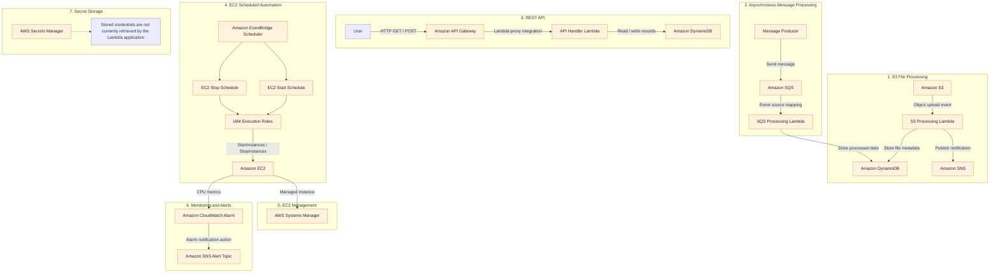

# AWS Automation, Serverless and Event-Driven Application

A hands-on AWS cloud project demonstrating serverless computing, event-driven architecture, automated EC2 operations, monitoring, and secure cloud resource management.

The project combines multiple AWS services to build automated workflows for file processing, message processing, REST API operations, scheduled EC2 management, and infrastructure monitoring.

---

## Project Overview

This project explores how AWS managed services can work together to build scalable, event-driven, and operationally efficient cloud solutions.

The implementation includes:

- Automated file processing using Amazon S3 and AWS Lambda.
- Metadata storage using Amazon DynamoDB.
- Notifications using Amazon SNS.
- Asynchronous message processing using Amazon SQS and Lambda.
- REST API development using Amazon API Gateway and Lambda.
- Scheduled EC2 start and stop operations using Amazon EventBridge Scheduler.
- EC2 management through AWS Systems Manager.
- CPU monitoring and alert configuration using Amazon CloudWatch.
- Secret storage using AWS Secrets Manager.

**Project region:** `ap-northeast-3` — Asia Pacific (Osaka)

**Implementation status:** Core AWS resources and workflows have been configured. Individual workflow documentation records the implementation details and validation status. Not every workflow's final end-to-end test has been independently confirmed.

---

## Architecture Overview

The following diagram represents the project's main workflows and how the AWS services interact.



> **Architecture note:** Secrets Manager is configured for secret storage. It is not currently connected to the Lambda application. The dotted relationship above is an explanatory note, not an active integration.

---

## AWS Services Used

| AWS Service | Purpose |
|---|---|
| Amazon S3 | Object storage and upload-event source |
| AWS Lambda | Serverless processing and API logic |
| Amazon DynamoDB | NoSQL storage for file metadata and application records |
| Amazon SNS | Notifications and alert delivery integration |
| Amazon SQS | Asynchronous message queue |
| Amazon API Gateway | REST API entry point |
| Amazon EventBridge Scheduler | Scheduled EC2 start and stop operations |
| Amazon EC2 | Virtual machine used for management and automation exercises |
| AWS Systems Manager | Remote EC2 management and Run Command |
| Amazon CloudWatch | CPU monitoring and alarm configuration |
| AWS Secrets Manager | Secure storage of application credentials |
| AWS IAM | Roles and permissions for AWS service access |

---

## Project Workflows

### 1. S3 File Processing

**Workflow:** Amazon S3 → AWS Lambda → DynamoDB → SNS

When an object is uploaded to the S3 bucket, an event invokes the processing Lambda function.

The Lambda function:
- Reads the uploaded object's bucket and key.
- Retrieves the file from S3.
- Calculates the file size.
- Stores file metadata in DynamoDB.
- Publishes a processing notification through SNS.

**Validation status:** The S3 upload, Lambda processing, DynamoDB write, and SNS notification workflow was successfully tested.

Documentation: [S3 File Processing Workflow](workflows/01-s3-file-processing.md)

### 2. SQS Message Processing

**Workflow:** Message Producer → SQS → Lambda → DynamoDB

Amazon SQS provides asynchronous message handling. A Lambda event source mapping reads messages from the queue and processes their contents.

The processing function:
- Reads records delivered by SQS.
- Parses the JSON message body.
- Stores message information in DynamoDB.

**Validation status:** Queue, Lambda, and event source mapping were configured. Final end-to-end test success has not been confirmed.

Documentation: [SQS Message Processing Workflow](workflows/02-sqs-message-processing.md)

### 3. REST API Using API Gateway and Lambda

**Workflow:** Client → API Gateway → Lambda → DynamoDB

A REST API exposes GET and POST operations through API Gateway.

Implemented operations:

| Method | Purpose |
|---|---|
| GET | Retrieve records from DynamoDB |
| POST | Create a new record in DynamoDB |

The API uses Lambda proxy integration. A Decimal-to-JSON serialization issue encountered during GET handling was corrected in the Lambda code.

**Deployment:** `dev` stage

**Invoke URL:**

`https://q555bidw9k.execute-api.ap-northeast-3.amazonaws.com/dev`

Example endpoint paths:

- `GET /`
- `POST /`

The API documentation includes request examples, expected response formats, and testing instructions. Final successful GET and POST test results are not claimed here.

Documentation: [API Gateway REST API](workflows/03-api-gateway-rest-api.md)

### 4. EventBridge EC2 Automation

**Workflow:** EventBridge Scheduler → IAM Execution Role → EC2

Two daily schedules were configured:

- EC2 Start Schedule
- EC2 Stop Schedule

The schedules use AWS SDK service targets to invoke the EC2 `StartInstances` and `StopInstances` operations.

Dedicated IAM roles provide the required permissions.

**Validation status:** EC2 start and stop operations were reported as working.

Documentation: [EventBridge EC2 Automation](workflows/04-eventbridge-ec2-automation.md)

### 5. Systems Manager EC2 Management

AWS Systems Manager is used to manage the EC2 instance without depending exclusively on direct SSH access.

Configured capabilities include:
- Managed instance registration.
- Systems Manager agent status checks.
- Fleet Manager visibility.
- Run Command using `AWS-RunShellScript`.

**Validation status:** The instance appeared Online in Systems Manager, and Run Command execution was successful.

Documentation: [Systems Manager EC2 Management](workflows/05-systems-manager-ec2-management.md)

### 6. CloudWatch Monitoring and Alerts

Amazon CloudWatch monitors EC2 CPU utilization.

Configured alarm:

| Setting | Value |
|---|---|
| Alarm name | `Yash-EC2-High-CPU-Alarm` |
| Metric | CPUUtilization |
| Threshold | Greater than 80% |
| Period | 5 minutes |
| Notification integration | SNS |

The alarm is configured to use an SNS topic for notifications.

**Validation status:** Alarm and SNS integration were configured. Actual notification delivery is not independently confirmed.

Documentation: [CloudWatch Monitoring and Alerts](workflows/06-cloudwatch-monitoring-and-alerts.md)

### 7. Secrets Manager

AWS Secrets Manager is used to store application credential fields securely.

Configured secret:

`Yash-Application-Secret`

The secret is active. Its values are intentionally excluded from this repository.

**Important:** The Lambda application does not currently retrieve this secret. Integrating Secrets Manager with Lambda is a future improvement.

Documentation: [AWS Secrets Manager](security/aws-secrets-manager.md)

---

## Repository Structure

```text
aws-automation-serverless-event-driven-app/
│
├── README.md
│
├── architecture/
│   ├── README.md
│   └── aws-architecture.md
│
├── workflows/
│   ├── 01-s3-file-processing.md
│   ├── 02-sqs-message-processing.md
│   ├── 03-api-gateway-rest-api.md
│   ├── 04-eventbridge-ec2-automation.md
│   ├── 05-systems-manager-ec2-management.md
│   └── 06-cloudwatch-monitoring-and-alerts.md
│
├── security/
│   └── aws-secrets-manager.md
│
├── deployment/
│   └── deployment-guide.md
│
├── screenshots/
│   └── README.md
│
├── troubleshooting/
   └── README.md

```

Additional screenshot subdirectories can be added as evidence is collected.

---

## Technologies and Tools

| Category | Technologies |
|---|---|
| Cloud Platform | Amazon Web Services |
| Programming Language | Python 3.12 |
| AWS SDK | Boto3 |
| Serverless | AWS Lambda |
| Storage | Amazon S3, Amazon DynamoDB |
| Messaging | Amazon SQS, Amazon SNS |
| API | Amazon API Gateway |
| Automation | Amazon EventBridge Scheduler |
| Monitoring | Amazon CloudWatch |
| Instance Management | Amazon EC2, AWS Systems Manager |
| Security | AWS IAM, AWS Secrets Manager |
| Documentation | Markdown, Mermaid |
| Version Control | Git and GitHub |

---

## Security Practices

The project follows several AWS security practices:

- IAM roles are used for service-to-service permissions.
- Lambda permissions are configured through an execution role.
- A least-privilege policy was created for the Lambda workflows.
- S3, DynamoDB, SNS, and SQS permissions are scoped to the relevant resources where configured.
- EventBridge schedules use dedicated IAM execution roles.
- EC2 management uses Systems Manager.
- Secret values and credentials are excluded from GitHub documentation.
- Account-specific identifiers, instance IDs, and full resource ARNs are not published.

**Security improvement areas:** API authentication, further IAM policy review, secret retrieval from Lambda, and more comprehensive access testing.

---

## Validation and Troubleshooting

The project includes dedicated documentation for implementation checks and common issues.

- [Deployment Guide](deployment/deployment-guide.md)
- [Troubleshooting Guide](troubleshooting/README.md)
- [Screenshots and Evidence Guide](screenshots/README.md)

Some workflows have confirmed successful validation, while others still require final end-to-end testing. Refer to each workflow document for its specific status rather than assuming every component has passed every test.

---

## Key Learning Outcomes

Through this project, I have gained practical exposure to:

- Building serverless applications using AWS Lambda.
- Creating event-driven workflows with S3 and EventBridge.
- Processing asynchronous messages using SQS.
- Storing and retrieving application records using DynamoDB.
- Publishing notifications using SNS.
- Creating REST APIs using API Gateway and Lambda.
- Automating EC2 operations using EventBridge Scheduler.
- Managing EC2 instances using Systems Manager.
- Monitoring AWS resources using CloudWatch.
- Applying IAM permissions and understanding least privilege.
- Documenting cloud architecture and troubleshooting implementation issues.

---

## Future Improvements

Potential next improvements include:

1. Integrate AWS Secrets Manager with Lambda using secure runtime retrieval.
2. Add API authentication and authorization.
3. Configure an SQS dead-letter queue (DLQ).
4. Implement idempotent SQS message processing.
5. Add automated unit and integration tests.
6. Provision resources using Terraform or AWS CloudFormation.
7. Build a CI/CD pipeline for Lambda deployments.
8. Create CloudWatch dashboards and improve alert validation.
9. Review backup, recovery, and operational procedures.
10. Add verified screenshots and execution evidence for each workflow.

---

## Important Notes

- This repository is a learning and portfolio project.
- Resource names are documented for identification, but AWS account-specific IDs and secret values are intentionally omitted.
- The AWS resources were created in `ap-northeast-3`.
- AWS services may incur charges while resources are running.
- Review and disable recurring EventBridge schedules when they are no longer required.
- Follow the deployment guide's cleanup instructions before removing project resources.

---

## Author

**Yash Satyavan Jogdand**

Computer Engineering | AWS | Cloud Computing | DevOps

- GitHub: [yash-jogdand](https://github.com/yash-jogdand)
- Project Repository: [AWS Automation, Serverless and Event-Driven Application](https://github.com/yash-jogdand/aws-automation-serverless-event-driven-app)

---

*This project is part of my hands-on learning journey in AWS, cloud infrastructure, serverless architecture, and DevOps engineering.*
