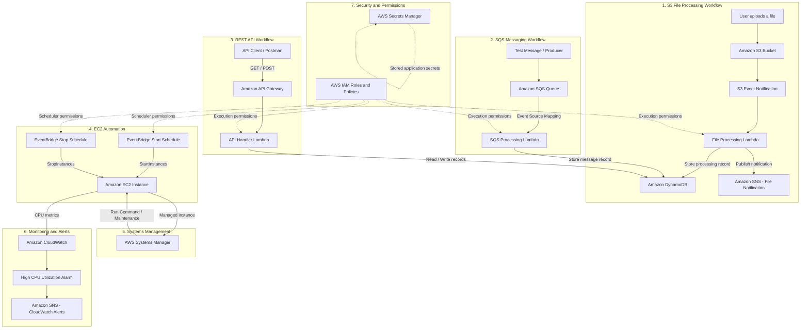

# AWS Serverless and Event-Driven Application – Architecture

## 1. Project Overview

This project demonstrates an AWS-based serverless and event-driven application that integrates cloud storage, serverless computing, database services, messaging, REST APIs, automation, monitoring, and security.

The architecture consists of independent workflows connected through AWS-managed services. Each workflow demonstrates a different cloud engineering concept and practical AWS integration.

**AWS Region:** Asia Pacific (Osaka) – `ap-northeast-3`

## 2. Complete AWS Architecture Diagram

The following diagram illustrates the major components and their interactions.

## 3. Architecture Components

| AWS Service | Component | Responsibility |
|---|---|---|
| Amazon S3 | Storage bucket | Stores uploaded files |
| S3 Event Notifications | Event trigger | Invokes Lambda when an object is uploaded |
| AWS Lambda | File processing function | Reads uploaded files and processes their information |
| AWS Lambda | SQS processing function | Processes messages received from SQS |
| AWS Lambda | API handler function | Handles REST API requests |
| Amazon DynamoDB | NoSQL database | Stores file-processing and application records |
| Amazon SNS | File notification topic | Publishes file-processing notifications |
| Amazon SQS | Message queue | Supports asynchronous message processing |
| Amazon API Gateway | REST API | Exposes GET and POST endpoints |
| EventBridge Scheduler | Start/stop schedules | Automates EC2 instance operations |
| Amazon EC2 | Compute instance | Target of automation and maintenance exercises |
| AWS Systems Manager | Run Command | Executes maintenance and verification commands |
| Amazon CloudWatch | Monitoring | Collects metrics and evaluates alarms |
| Amazon SNS | CloudWatch alert topic | Receives CloudWatch alarm notifications |
| AWS Secrets Manager | Secret storage | Stores application secret values |
| AWS IAM | Roles and policies | Controls service access and permissions |

## 4. Detailed Workflow Explanation

### 4.1 S3 File Processing

1. A user uploads a file to the S3 bucket.
2. S3 generates an object-created event.
3. The event notification invokes the file-processing Lambda function.
4. Lambda reads the uploaded object from S3.
5. Lambda extracts information such as the filename and file size.
6. Processing information is stored in DynamoDB.
7. Lambda publishes a successful-processing notification through SNS.

### 4.2 SQS Message Processing

1. A message is sent to the SQS queue.
2. Lambda receives the message through an event source mapping.
3. The SQS processing Lambda reads the message body.
4. The message information is stored in DynamoDB.
5. Following successful processing, the message is deleted from the queue by the Lambda event source mapping.

### 4.3 REST API Integration

1. An API client sends a request to API Gateway.
2. API Gateway forwards the request to the API Lambda function.
3. POST creates a new record in DynamoDB.
4. GET retrieves existing records from DynamoDB.
5. Lambda returns a JSON response to API Gateway.

### 4.4 EC2 Automation

1. EventBridge Scheduler invokes the configured EC2 start operation.
2. The associated IAM role authorizes the operation.
3. EC2 receives the start request.
4. A separate EventBridge schedule invokes the stop operation.
5. The associated stop role authorizes the stop request.

### 4.5 Systems Manager Maintenance

1. The EC2 instance is configured as a Systems Manager managed node.
2. Systems Manager Run Command executes maintenance commands.
3. The command output and execution status can be reviewed in the Systems Manager console.

### 4.6 CloudWatch Monitoring

1. CloudWatch collects EC2 performance metrics.
2. A CPU utilization alarm evaluates the configured threshold.
3. When the alarm condition is met, CloudWatch changes the alarm state.
4. The configured SNS topic receives the alarm notification.

### 4.7 Secrets Management

AWS Secrets Manager is used to store application secret values securely. Secret storage is separate from the application's source code.

**Note:** The current API Lambda does not retrieve the stored secret. This component represents the secret-management setup, not an active Lambda-to-Secrets-Manager integration.

## 5. Security Architecture

The project demonstrates the following security practices:

- Dedicated Lambda functions for separate application responsibilities.
- IAM roles for AWS service execution.
- Restricted permissions for required project resources.
- Separate EventBridge execution roles for EC2 start and stop operations.
- S3 object access restricted to the project bucket.
- DynamoDB access restricted to the project table.
- SQS and SNS permissions scoped to the project resources.
- Secrets stored in Secrets Manager instead of source code.

## 6. Architecture Design Principles

- **Event-driven:** Services communicate through events and messaging.
- **Serverless:** Lambda handles application processing without managing servers.
- **Decoupled:** Separate workflows and functions reduce direct dependencies.
- **Scalable:** Managed AWS services support changing workloads.
- **Observable:** CloudWatch provides monitoring and alarm capabilities.
- **Secure:** IAM roles and scoped permissions control access.

## 7. Project Implementation Status

| Component | Implementation |
|---|---|
| S3 file processing | Completed |
| SQS message processing | Completed |
| REST API integration | Implemented |
| EventBridge EC2 automation | Completed |
| Systems Manager maintenance | Completed |
| CloudWatch alarm | Configured |
| Secrets Manager | Configured |
| IAM least-privilege policy | Configured |

## 8. Conclusion

This architecture demonstrates how multiple AWS services can be integrated to build a serverless, event-driven application with automated infrastructure operations, monitoring, and security controls.

The project provides practical exposure to AWS service integration and foundational cloud engineering concepts.
