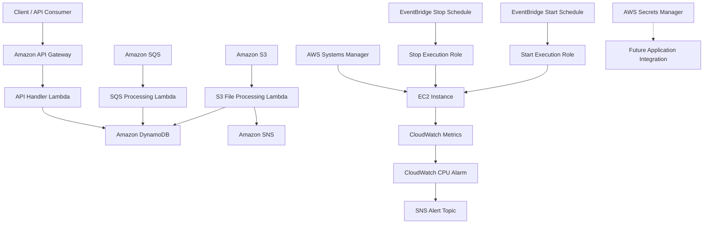
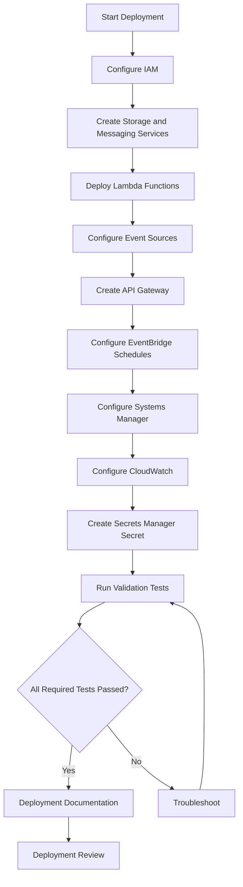

# AWS Automation, Serverless and Event-Driven Application – Deployment Guide

## 1. Project Overview

This project demonstrates an AWS-based automation and serverless architecture that combines event-driven processing, REST API integration, EC2 automation, centralized management, monitoring, and secure credential storage.

The project uses multiple AWS services to demonstrate how different cloud components can work together to build an automated and manageable infrastructure.

### Project Objectives

- Build an event-driven file-processing workflow using Amazon S3.
- Process messages using Amazon SQS and AWS Lambda.
- Store application records in Amazon DynamoDB.
- Send processing notifications using Amazon SNS.
- Expose application functionality using Amazon API Gateway.
- Automate EC2 start and stop operations using EventBridge Scheduler.
- Manage EC2 instances using AWS Systems Manager.
- Monitor EC2 performance using Amazon CloudWatch.
- Store application credentials securely using AWS Secrets Manager.

## 2. Project Information

| Property | Details |
|---|---|
| Project name | AWS Automation, Serverless and Event-Driven Application |
| Repository | aws-automation-serverless-event-driven-app |
| Cloud provider | Amazon Web Services |
| AWS Region | ap-northeast-3 |
| Region name | Asia Pacific (Osaka) |
| Main language | Python |
| AWS SDK | Boto3 |
| Infrastructure type | Serverless and event-driven |
| Documentation | GitHub Markdown |

## 3. AWS Services and Resources

| Service | Project Resource |
|---|---|
| Amazon S3 | yash-serverless-file-processing-2026 |
| AWS Lambda | Yash-File-Processing-Lambda |
| AWS Lambda | Yash-SQS-Processing-Lambda |
| AWS Lambda | Yash-API-Handler-Lambda |
| Amazon DynamoDB | Yash-FileProcessing-Table |
| Amazon SNS | Yash-FileProcessing-Notifications |
| Amazon SQS | Yash-FileProcessing-Queue |
| Amazon API Gateway | Yash-Serverless-REST-API |
| EventBridge Scheduler | Yash-EC2-Start-Schedule |
| EventBridge Scheduler | Yash-EC2-Stop-Schedule |
| IAM | Lambda and EventBridge execution roles |
| AWS Systems Manager | EC2 managed-node administration |
| Amazon CloudWatch | Yash-EC2-High-CPU-Alarm |
| AWS Secrets Manager | Yash-Application-Secret |

## 4. High-Level Architecture

**Important architecture notes:**

- The S3 workflow processes uploaded objects and stores their metadata in DynamoDB.
- The SQS workflow processes queued messages and writes records to DynamoDB.
- The REST API provides GET and POST operations through Lambda.
- EventBridge Scheduler invokes EC2 start and stop operations directly through AWS SDK service integrations.
- Systems Manager provides remote EC2 administration.
- CloudWatch monitors EC2 CPU utilization and integrates with SNS.
- Secrets Manager stores credentials but is not currently integrated into Lambda application code.

## 5. Prerequisites

Before deploying or reproducing the project, ensure the following requirements are available.

### AWS Account

- An active AWS account.
- Access to the AWS Management Console.
- Appropriate permissions to create and configure the required AWS services.
- Billing access to review project costs.

### Required Knowledge

- Basic AWS service concepts.
- Basic Python programming.
- JSON configuration.
- IAM roles and policies.
- Linux fundamentals.
- Basic understanding of serverless architecture.

### Required Tools

| Tool | Purpose |
|---|---|
| Web browser | AWS Management Console |
| Git | Version control |
| GitHub | Project documentation and source control |
| Python 3.12 | Lambda runtime |
| Boto3 | AWS SDK for Python |
| Linux terminal | EC2 administration |

## 6. Deployment Sequence

The following sequence represents the logical implementation order of the project.

### Phase 1 – Identity and Storage

1. Configure the required IAM roles.
2. Create the S3 bucket.
3. Create the DynamoDB table.
4. Create the SNS notification topic.
5. Create the SQS queue.

### Phase 2 – Serverless Processing

6. Create the S3 file-processing Lambda.
7. Configure the S3 event notification.
8. Test file uploads and DynamoDB processing.
9. Create the SQS processing Lambda.
10. Configure the SQS event source mapping.
11. Test message processing.

### Phase 3 – API Integration

12. Create the API handler Lambda.
13. Configure DynamoDB permissions.
14. Create the API Gateway REST API.
15. Configure GET and POST methods.
16. Configure Lambda proxy integration.
17. Deploy the API to the dev stage.
18. Test the API endpoints.

### Phase 4 – EC2 Automation

19. Configure the EventBridge Scheduler start role.
20. Create the EC2 start schedule.
21. Configure the EventBridge Scheduler stop role.
22. Create the EC2 stop schedule.
23. Verify EC2 start and stop operations.

### Phase 5 – Management and Monitoring

24. Attach the Systems Manager instance role to EC2.
25. Verify the SSM Agent and managed-node status.
26. Execute Linux commands through Run Command.
27. Configure the CloudWatch CPU alarm.
28. Integrate the alarm with the SNS alert topic.

### Phase 6 – Security

29. Create the Secrets Manager secret.
30. Review IAM permissions.
31. Verify that credentials are not exposed in source code.
32. Review security and access-control configurations.

## 7. Deployment Workflow Diagram

## 8. Application Configuration

### 8.1 S3 File Processing

The S3 Lambda receives an object-created event.

It:
1. Extracts the bucket and object key.
2. Retrieves the uploaded file.
3. Calculates the file size.
4. Creates a file identifier.
5. Stores metadata in DynamoDB.
6. Publishes a processing notification to SNS.

### 8.2 SQS Message Processing

The SQS Lambda receives queued messages through an event source mapping.

It:
1. Reads the SQS message body.
2. Parses the JSON message.
3. Extracts the required fields.
4. Writes the record to DynamoDB.
5. Returns a successful response when processing completes.

Standard SQS queues provide at-least-once delivery. Production implementations should account for duplicate messages and consider a dead-letter queue.

### 8.3 API Gateway

The REST API exposes application functionality through HTTP methods.

| Method | Operation | Expected Response |
|---|---|---|
| GET | Retrieve DynamoDB records | HTTP 200 |
| POST | Create a new record | HTTP 201 |

The API uses Lambda proxy integration.

The deployed development-stage invoke URL is:

`https://q555bidw9k.execute-api.ap-northeast-3.amazonaws.com/dev`

**Security note:** This is the project's development endpoint. Do not assume that authentication or authorization is configured unless separately verified.

### 8.4 EC2 Automation

EventBridge Scheduler invokes the EC2 StartInstances and StopInstances API operations through dedicated IAM roles.

The configured schedules use:

`rate(1 day)`

The schedules are recurring, so verify their enabled status and intended timing before using them in an environment where EC2 availability matters.

### 8.5 Systems Manager

Systems Manager provides remote administration through the SSM Agent and an EC2 IAM instance role.

Run Command was used to execute Linux maintenance and agent-status commands.

### 8.6 CloudWatch Monitoring

CloudWatch monitors the EC2 CPUUtilization metric.

The project alarm uses:
- Threshold: greater than 80%.
- Period: 5 minutes.
- Notification integration: SNS.

The actual alarm evaluation periods should be reviewed in the AWS console.

### 8.7 Secrets Manager

The secret `Yash-Application-Secret` stores username and password fields.

The secret was created and verified as active. Lambda retrieval integration is not currently implemented.

## 9. Deployment Validation

Use the following checklist to review the deployed resources.

| Component | Validation |
|---|---|
| S3 bucket | Bucket exists and file upload works |
| S3 Lambda | Upload triggers processing |
| DynamoDB | File metadata is stored |
| SNS | Notification publishing is configured |
| SQS | Queue receives messages |
| SQS Lambda | Event source mapping processes messages |
| API Gateway | Dev stage is deployed |
| API GET | Returns records successfully |
| API POST | Creates records successfully |
| EventBridge Start | EC2 start operation works |
| EventBridge Stop | EC2 stop operation works |
| Systems Manager | Managed node is Online |
| Run Command | Linux commands execute successfully |
| CloudWatch | CPU alarm exists with expected threshold |
| Secrets Manager | Secret exists and is active |

Some validations require fresh execution against the AWS environment. A configured resource should not automatically be considered successfully tested.

## 10. Security Considerations

Security is an important part of this project.

### IAM

- Use dedicated execution roles.
- Apply least-privilege permissions.
- Restrict EC2 start and stop permissions to the intended instance.
- Avoid broad wildcard permissions.

### S3

- Keep bucket access restricted.
- Avoid public access unless explicitly required.
- Use encryption and suitable bucket policies.

### Lambda

- Use execution roles rather than hardcoded credentials.
- Validate incoming event data.
- Avoid logging sensitive information.
- Handle processing errors appropriately.

### DynamoDB

- Restrict access to required tables and operations.
- Avoid unnecessary data exposure through API responses.

### SQS and SNS

- Restrict queue and topic permissions.
- Use appropriate encryption and access controls.
- Consider dead-letter queues and retry handling.

### API Gateway

- Configure authentication and authorization for production use.
- Validate incoming requests.
- Avoid exposing sensitive database information.

### Secrets Manager

- Never commit secret values to GitHub.
- Restrict secret access through IAM.
- Consider secret rotation where appropriate.

## 11. Cost Management

AWS resources can continue generating charges even when they are not actively used.

Review the following resources regularly:

- S3 storage and requests.
- Lambda invocation and execution duration.
- DynamoDB capacity and requests.
- SQS requests.
- SNS notifications.
- API Gateway requests.
- CloudWatch alarms, metrics, and logs.
- Secrets Manager secret storage and API requests.
- EC2 running time and associated storage.
- EventBridge Scheduler schedules.

### Important EC2 Schedule Warning

The project's start and stop schedules use daily recurring expressions.

Before leaving the project unattended:
1. Open EventBridge Scheduler.
2. Review both schedules.
3. Confirm their intended execution behavior.
4. Disable schedules that are no longer required.

Do not assume that stopping an EC2 instance automatically disables its recurring start schedule.

## 12. Cleanup Considerations

If the project is no longer required, resources should be reviewed and removed carefully.

A possible cleanup sequence is:

1. Disable EventBridge Scheduler schedules.
2. Review and remove API Gateway resources if no longer required.
3. Remove Lambda event source mappings.
4. Remove S3 event notifications.
5. Remove Lambda functions.
6. Review and remove SQS queues.
7. Review and remove SNS topics.
8. Delete DynamoDB tables after backing up required data.
9. Review and delete Secrets Manager secrets.
10. Review IAM roles and policies before deleting unused identities.
11. Review CloudWatch alarms and log groups.
12. Review and terminate EC2 instances.
13. Review associated EBS volumes and snapshots.
14. Confirm no unwanted resources remain.

**Warning:** Do not delete resources without checking dependencies and retaining any data you need. Secret deletion and DynamoDB deletion can affect future recovery.

## 13. Troubleshooting

| Problem | Recommended Check |
|---|---|
| S3 upload does not trigger Lambda | Check S3 event notification and Lambda permission |
| Lambda fails | Review CloudWatch Logs |
| DynamoDB record not created | Check table name, key schema, and IAM permissions |
| SNS notification missing | Check topic ARN, permissions, and subscriptions |
| SQS messages remain in queue | Check Lambda event source mapping and execution errors |
| API returns 502 | Check Lambda execution logs and response format |
| EC2 does not start or stop | Review Scheduler target, role, and instance permissions |
| SSM node is Offline | Check instance role, SSM Agent, and network connectivity |
| CloudWatch alarm not changing state | Review metric dimensions and evaluation settings |
| Secret retrieval fails | Check IAM permissions, secret identifier, and KMS policy |

## 14. Final Project Outcome

This project demonstrates the integration of multiple AWS services to build an automated, serverless, and event-driven application environment.

It covers file processing, asynchronous message processing, REST API operations, scheduled EC2 automation, centralized instance management, monitoring, alerting, and secure credential storage.

The implementation provides practical experience with AWS service integration, IAM permissions, event-driven workflows, operational troubleshooting, and cloud security.

## 15. Future Improvements

Potential improvements for a future version include:

- Integrate Secrets Manager with Lambda.
- Add SQS dead-letter queues.
- Improve idempotency for message processing.
- Add API authentication and request validation.
- Add automated deployment using AWS SAM or Terraform.
- Implement structured application logging.
- Configure CloudWatch dashboards.
- Add more detailed alerting and notification verification.
- Implement automated testing and CI/CD.
- Add backup and disaster recovery procedures.

---

**Project:** AWS Automation, Serverless and Event-Driven Application  
**AWS Region:** ap-northeast-3 (Asia Pacific – Osaka)  
**Documentation Section:** Deployment and Operations  
**Author:** Yash Satyavan Jogdand  
**GitHub:** [yash-jogdand](https://github.com/yash-jogdand)
