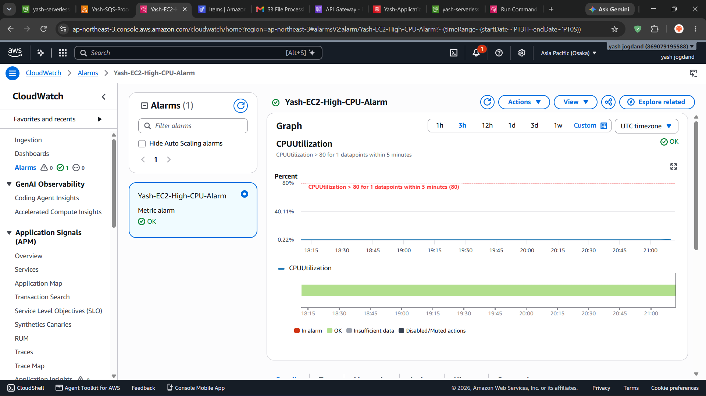
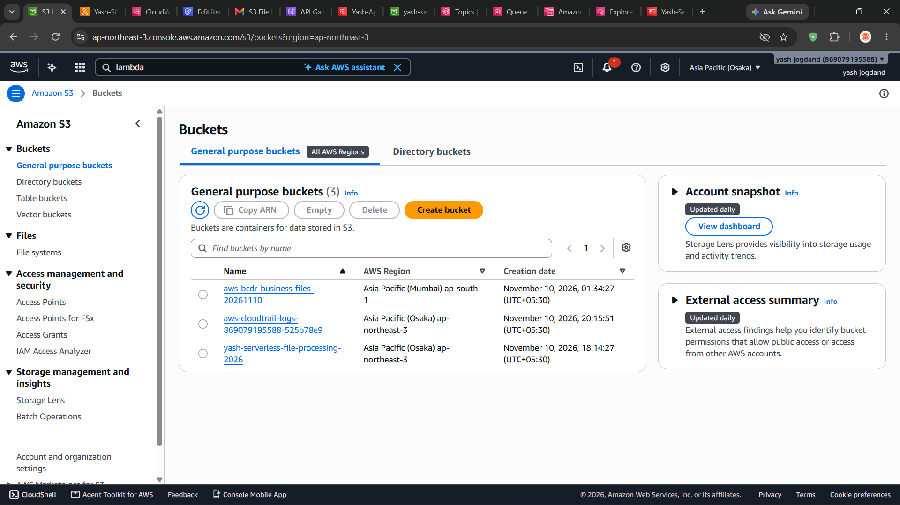
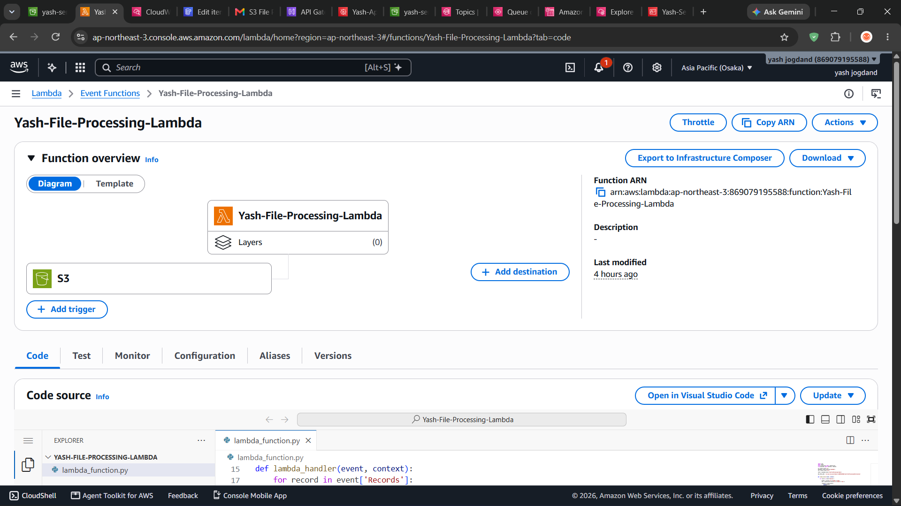
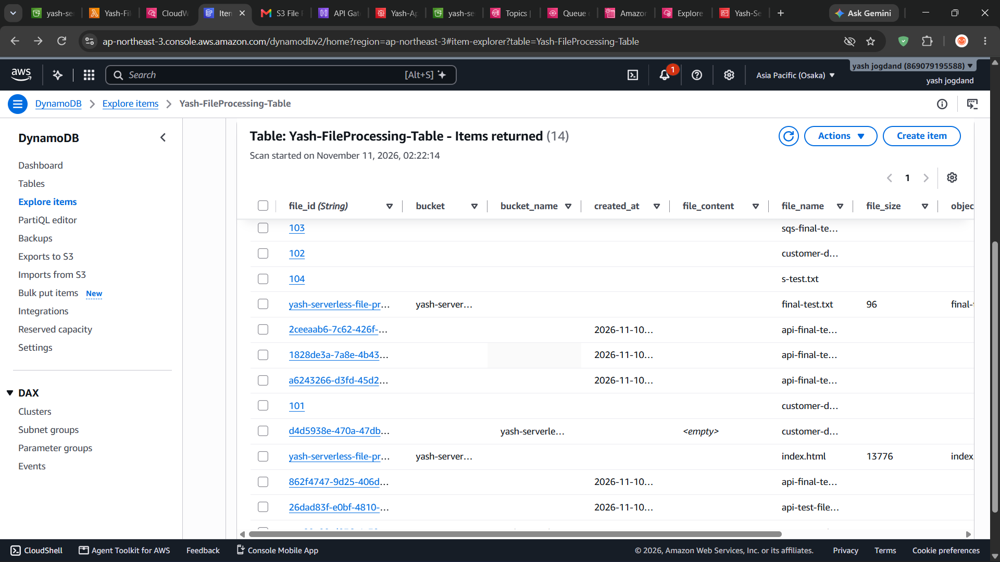
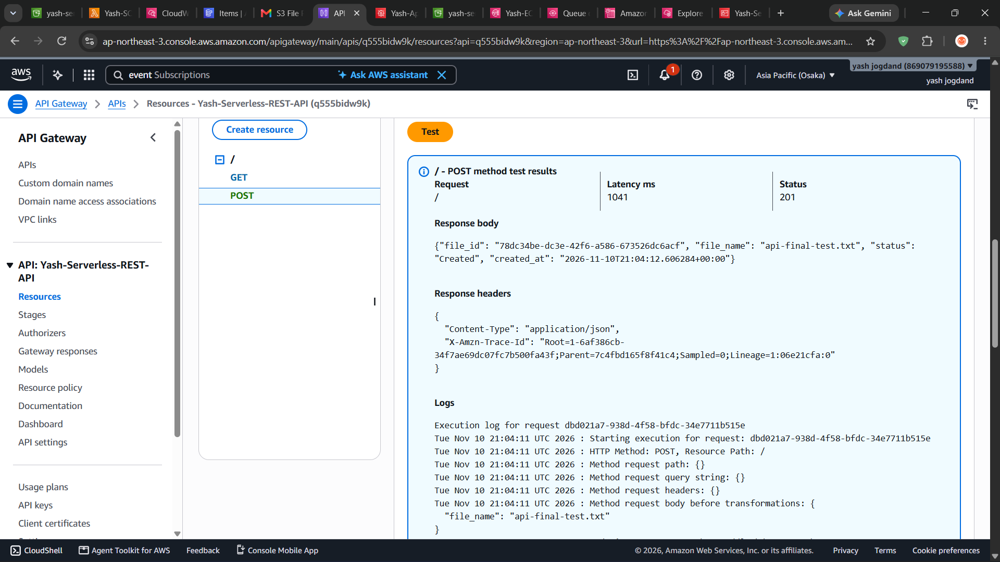
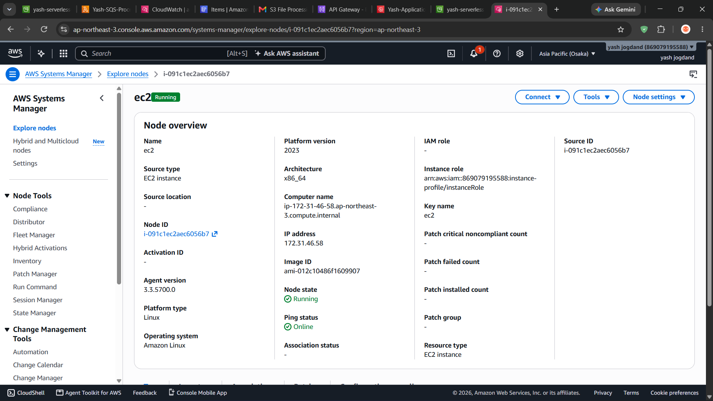
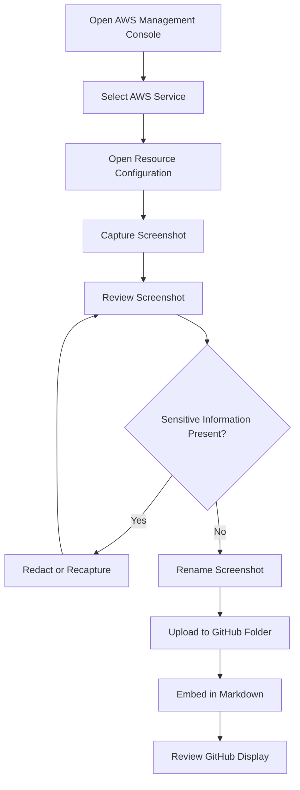

# AWS Project – Screenshots and Implementation Evidence

## 1. Overview

This directory contains screenshots documenting the implementation, configuration, and validation of the AWS Automation, Serverless and Event-Driven Application project.

Screenshots provide visual evidence of AWS resource configurations and successful workflow execution.

The objective is to make the project easier to understand and review through GitHub.

## 2. Screenshot Objectives

The screenshots are intended to demonstrate:

- AWS service configurations.
- Lambda function implementations.
- S3 file-processing workflow.
- SQS message-processing workflow.
- DynamoDB data storage.
- SNS notification configuration.
- API Gateway deployment.
- EventBridge scheduled EC2 automation.
- Systems Manager instance management.
- CloudWatch monitoring and alarms.
- Secrets Manager configuration.

## 3. Recommended Folder Structure

Organize screenshots using the following structure:

```text
screenshots/
│
├── README.md
│
├── 01-iam/
│   ├── lambda-execution-role.png
│   ├── eventbridge-start-role.png
│   └── eventbridge-stop-role.png
│
├── 02-s3/
│   ├── s3-bucket-overview.png
│   ├── uploaded-test-file.png
│   └── s3-lambda-trigger.png
│
├── 03-lambda/
│   ├── s3-processing-lambda.png
│   ├── sqs-processing-lambda.png
│   └── api-handler-lambda.png
│
├── 04-dynamodb/
│   ├── dynamodb-table-overview.png
│   └── processed-file-record.png
│
├── 05-sns/
│   ├── sns-file-processing-topic.png
│   └── sns-alert-topic.png
│
├── 06-sqs/
│   ├── sqs-queue-overview.png
│   ├── sqs-event-source-mapping.png
│   └── sqs-message-processing.png
│
├── 07-api-gateway/
│   ├── rest-api-overview.png
│   ├── api-methods.png
│   ├── api-deployment.png
│   └── api-test-results.png
│
├── 08-eventbridge/
│   ├── ec2-start-schedule.png
│   ├── ec2-stop-schedule.png
│   └── scheduler-execution-roles.png
│
├── 09-systems-manager/
│   ├── managed-node-online.png
│   ├── run-command-configuration.png
│   └── run-command-success.png
│
├── 10-cloudwatch/
│   ├── ec2-cpu-metric.png
│   ├── high-cpu-alarm.png
│   └── alarm-history.png
│
└── 11-secrets-manager/
    ├── secret-overview.png
    └── secret-configuration.png
```

**Important:** Create only the folders and files for screenshots you actually capture. This structure is a recommended organization, not evidence that every listed screenshot already exists.

## 4. Screenshot Collection Checklist

### 4.1 IAM

Capture:

- Lambda execution role overview.
- Attached least-privilege policy.
- EventBridge EC2 start execution role.
- EventBridge EC2 stop execution role.

Recommended evidence:

Show the role name and policy attachment without exposing sensitive account information.

### 4.2 Amazon S3

Capture:

- S3 bucket overview.
- Uploaded test file.
- S3 event notification configuration.

Recommended evidence:

Show the test file `final-test.txt` and the event notification configuration.

### 4.3 AWS Lambda

Capture:

- S3 file-processing Lambda overview.
- SQS processing Lambda overview.
- API handler Lambda overview.
- Successful invocation or execution results.

Recommended evidence:

Show function names, runtime information, and successful execution results where available.

Do not expose credentials or sensitive environment variables.

### 4.4 Amazon DynamoDB

Capture:

- `Yash-FileProcessing-Table` overview.
- Partition key configuration.
- Successfully processed file record.

Recommended evidence:

Show the `file_id` partition key and a processed file record.

### 4.5 Amazon SNS

Capture:

- `Yash-FileProcessing-Notifications` topic.
- `Yash-EC2-CloudWatch-Alerts` topic.
- Subscription configuration, if applicable.

Recommended evidence:

Show the topic names and subscription status without displaying private subscriber information.

### 4.6 Amazon SQS

Capture:

- `Yash-FileProcessing-Queue` overview.
- Queue configuration.
- Lambda event source mapping.
- Successful message-processing execution, if verified.

Recommended evidence:

Show queue settings such as visibility timeout, message retention, and server-side encryption.

### 4.7 API Gateway

Capture:

- REST API overview.
- GET and POST methods.
- Lambda integration configuration.
- Development-stage deployment.
- GET response.
- POST response.

Recommended evidence:

Show the API stage and successful HTTP responses.

Do not expose sensitive response data.

### 4.8 EventBridge Scheduler

Capture:

- `Yash-EC2-Start-Schedule`.
- `Yash-EC2-Stop-Schedule`.
- Schedule expressions.
- Target configuration.
- Execution role configuration.

Recommended evidence:

Show the daily recurrence expression and EC2 API operation.

Hide the actual EC2 instance ID and account-specific ARN.

### 4.9 AWS Systems Manager

Capture:

- Managed node listed as Online.
- Run Command configuration.
- Successful command execution.
- Command output.

Recommended evidence:

Show the managed-node status and successful execution of the Linux commands.

### 4.10 Amazon CloudWatch

Capture:

- EC2 CPUUtilization metric.
- `Yash-EC2-High-CPU-Alarm`.
- Alarm threshold configuration.
- Alarm history.
- SNS action configuration.

Recommended evidence:

Show the greater-than-80% threshold and five-minute period.

Only include an ALARM-state screenshot if the alarm actually entered that state during testing.

### 4.11 AWS Secrets Manager

Capture:

- `Yash-Application-Secret` overview.
- Secret metadata and status.

**Security warning:** Never capture or publish the actual secret values. Do not include screenshots that reveal the username, password, or other confidential information.

The screenshot should demonstrate that the secret exists without exposing its contents.

## 5. Screenshot Naming Convention

Use descriptive filenames.

Recommended pattern:

```text
service-purpose-status.png
```

Examples:

```text
s3-bucket-overview.png
lambda-s3-processing-success.png
dynamodb-processed-record.png
api-gateway-get-response.png
eventbridge-ec2-start-schedule.png
systems-manager-managed-node-online.png
cloudwatch-high-cpu-alarm.png
secrets-manager-secret-overview.png
```

Avoid generic names such as:

```text
image1.png
screenshot2.png
final.png
new-image.png
```

Descriptive names make the repository easier to maintain.

## 6. How to Capture Screenshots

For Windows:

1. Open the AWS Management Console.
2. Navigate to the AWS resource you want to document.
3. Adjust the browser zoom if necessary.
4. Make sure the important configuration or result is visible.
5. Press `Windows + Shift + S`.
6. Select the required screen area.
7. Save the screenshot as a PNG file.
8. Use the recommended filename.
9. Upload it into the corresponding GitHub folder.

Use clear, readable screenshots instead of capturing unnecessary portions of the screen.

## 7. Embedding Screenshots in GitHub Markdown

GitHub Markdown supports embedding repository images.

Example:

```markdown
## S3 Bucket Configuration


```

Another example:

```markdown
## CloudWatch Alarm


```

For the screenshots directory README, relative paths should point to files within the screenshots directory.

## 8. Creating a Screenshot Gallery

You can display selected screenshots in this README.

Use the following template after uploading the corresponding images:

```markdown
## Project Evidence

### S3 File Processing



### Lambda Processing



### DynamoDB Storage



### API Gateway



### Systems Manager



### CloudWatch Monitoring


```

Replace or remove any example whose image has not yet been uploaded.

## 9. Screenshot Security Guidelines

Before uploading screenshots to a public GitHub repository, inspect them carefully.

Never expose:

- AWS account IDs.
- Access keys or secret access keys.
- Passwords.
- Secret values.
- Database credentials.
- Private keys.
- Sensitive personal information.
- Unnecessary public IP addresses.
- Full account-specific resource ARNs.

Additional precautions:

- Blur or crop sensitive fields.
- Never screenshot the secret-value display in Secrets Manager.
- Avoid showing private subscriber email addresses.
- Avoid displaying sensitive API response information.
- Check browser URLs and console details before publishing.

If sensitive information is accidentally uploaded, removing the screenshot from the latest commit may not remove it from Git history. Treat exposed credentials as compromised and rotate them as appropriate.

## 10. Screenshot Evidence Workflow



## 11. Final Screenshot Checklist

| AWS Service | Screenshot Collection |
|---|---|
| IAM | Role and policy evidence |
| S3 | Bucket and upload evidence |
| Lambda | Function and execution evidence |
| DynamoDB | Table and record evidence |
| SNS | Topic and subscription evidence |
| SQS | Queue and event source evidence |
| API Gateway | API configuration and test evidence |
| EventBridge | Start/stop schedule evidence |
| Systems Manager | Managed node and Run Command evidence |
| CloudWatch | Metric and alarm evidence |
| Secrets Manager | Secret metadata evidence |

## 12. Project Documentation Status

This directory provides the structure and guidelines for maintaining visual implementation evidence.

Screenshots should be added progressively as resources and workflows are reviewed.

A screenshot should only be treated as proof of successful implementation when it clearly demonstrates the relevant configuration or test result.

---

**Project:** AWS Automation, Serverless and Event-Driven Application  
**AWS Region:** ap-northeast-3 (Asia Pacific – Osaka)  
**Documentation Section:** Screenshots and Visual Evidence  
**Author:** Yash Satyavan Jogdand  
**GitHub:** [yash-jogdand](https://github.com/yash-jogdand)
