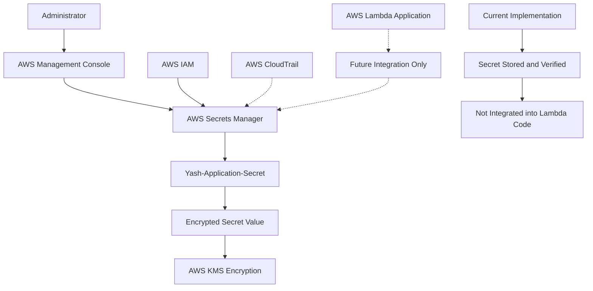
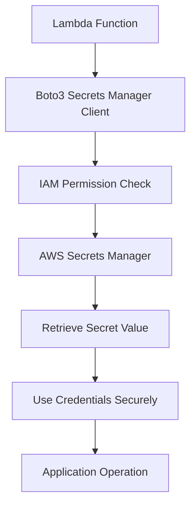

# AWS Secrets Manager – Secure Credential Storage

## 1. Overview

AWS Secrets Manager is a managed AWS service used to securely store, manage, retrieve, and rotate sensitive information such as application credentials, database passwords, API keys, and other secrets.

In this project, AWS Secrets Manager was used to create and store an application secret containing username and password fields.

The secret was created and verified as active. However, it was not connected to the Lambda application code as part of the current implementation.

### Objectives

- Understand AWS Secrets Manager.
- Create and store application credentials securely.
- Understand secret versions and encryption.
- Learn how IAM permissions control secret access.
- Understand secure secret retrieval.
- Identify how secrets can be integrated into applications.
- Follow best practices for protecting sensitive information.

## 2. AWS Services Used

| AWS Service | Purpose |
|---|---|
| AWS Secrets Manager | Secure credential storage |
| AWS KMS | Encryption of secret values |
| AWS IAM | Controls access to secrets |
| AWS Lambda | Potential consumer of secrets in a future integration |
| Amazon CloudTrail | Supports auditing of API activity |

## 3. Architecture Diagram



**Architecture clarification:** The dotted Lambda connection represents a possible future integration, not an active connection in this project.

## 4. Understanding AWS Secrets Manager

Secrets Manager provides centralized storage for sensitive application information.

### 4.1 Secret Storage

Sensitive values can be stored as:
- Username and password.
- Database credentials.
- API keys.
- Application configuration secrets.
- Other confidential values.

### 4.2 Encryption

Secrets Manager encrypts secret values using AWS Key Management Service (KMS).

This helps protect sensitive information at rest.

### 4.3 Secret Versions

Secrets Manager maintains versions of secrets.

When a secret is updated, a new version can be created. Version staging labels help identify versions such as:
- `AWSCURRENT`
- `AWSPREVIOUS`
- `AWSPENDING`

### 4.4 Access Control

IAM policies determine which users, roles, or AWS services can access a secret.

Access should be limited to only the identities that need it.

## 5. Project Secret Configuration

The following secret was created for this project.

| Configuration | Value |
|---|---|
| Secret name | Yash-Application-Secret |
| Secret type | Other type of secret |
| Secret fields | Username and password |
| Storage service | AWS Secrets Manager |
| Encryption | AWS-managed KMS encryption unless otherwise configured |
| Current status | Created and verified active |
| Lambda integration | Not implemented |

**Security warning:** Actual username and password values must never be published in GitHub documentation, source code, screenshots, or public repositories.

## 6. Secret Creation Workflow

The secret was created using the AWS Management Console.

### General configuration process

1. Open AWS Management Console.
2. Search for **Secrets Manager**.
3. Open AWS Secrets Manager.
4. Select **Store a new secret**.
5. Choose the appropriate secret type.
6. Enter the username and password fields.
7. Enter the secret name:

   `Yash-Application-Secret`

8. Continue through the configuration.
9. Review the encryption and other settings.
10. Create the secret.
11. Open the created secret.
12. Verify that it is active.

## 7. IAM Security and Access Management

IAM controls which identities can retrieve or modify secrets.

### Recommended permission

For an application that needs to retrieve this secret, the relevant permission is:

`secretsmanager:GetSecretValue`

A minimal example policy is shown below.

Replace the placeholder ARN with the actual secret ARN when configuring an application role. Never publish an account-specific ARN in public project documentation.

```json
{
  "Version": "2012-10-17",
  "Statement": [
    {
      "Effect": "Allow",
      "Action": [
        "secretsmanager:GetSecretValue"
      ],
      "Resource": "arn:aws:secretsmanager:ap-northeast-3:YOUR_ACCOUNT_ID:secret:Yash-Application-Secret-*"
    }
  ]
}
```

### Important IAM considerations

- Grant secret access only to the required IAM role.
- Avoid using wildcard permissions across all secrets.
- Do not give applications permission to modify secrets unless required.
- Review IAM access periodically.
- If a customer-managed KMS key is used, ensure the required KMS permissions and key policy are configured.

**Project status:** This example policy is an implementation reference. Do not claim that this permission was attached to the Lambda role unless it has actually been configured and verified.

## 8. Future Integration with AWS Lambda

Secrets Manager can be integrated with Lambda when an application needs to retrieve credentials securely at runtime.

For example, a future Lambda integration could retrieve the secret using Boto3.

### Illustrative Python Example

The following is an example for a future implementation. It was not part of the current project deployment.

```python
import boto3
import json

secrets_client = boto3.client("secretsmanager")

def get_application_secret():
    response = secrets_client.get_secret_value(
        SecretId="Yash-Application-Secret"
    )

    secret_data = json.loads(response["SecretString"])

    return secret_data
```

### Future integration requirements

1. Attach a narrowly scoped IAM policy to the Lambda execution role.
2. Grant `secretsmanager:GetSecretValue` for the required secret.
3. Configure the secret name or ARN in Lambda environment configuration.
4. Retrieve the secret at runtime.
5. Avoid printing secret values in CloudWatch Logs.
6. Handle retrieval errors securely.
7. Consider caching secrets to reduce repeated API calls.

### Future Integration Architecture



This is a proposed future architecture and is not an active workflow in the current deployment.

## 9. Validation and Testing

The following checks describe the current implementation.

| Validation | Expected Result | Project Status |
|---|---|---|
| Secret creation | Secret exists | Completed |
| Secret name | Yash-Application-Secret | Verified |
| Username/password fields | Stored in secret | Configured |
| Secret status | Active | Verified |
| Secret values published to GitHub | No | Required security practice |
| Lambda retrieval integration | Application retrieves secret | Not implemented |
| Lambda IAM permission | Scoped secret retrieval permission | Not verified as configured |

## 10. Troubleshooting

### Issue 1: Access Denied When Retrieving a Secret

Possible causes:
- IAM role lacks `secretsmanager:GetSecretValue`.
- Resource ARN does not match the secret.
- KMS key policy denies access.
- Explicit IAM or resource policy deny exists.

Recommended actions:
1. Check the IAM identity used by the application.
2. Review the attached policies.
3. Verify the secret ARN.
4. Check the KMS key policy if using a customer-managed key.

### Issue 2: Secret Not Found

Possible causes:
- Incorrect secret name.
- Incorrect AWS region.
- Secret was deleted.
- Incorrect ARN supplied.

Recommended actions:
- Verify the secret name.
- Check the AWS region.
- Review the secret's status.
- Verify the configured identifier.

### Issue 3: Invalid Secret Format

Possible causes:
- Incorrect JSON structure.
- Missing expected fields.
- Application expects different field names.

Recommended actions:
- Review the expected secret structure.
- Validate JSON parsing.
- Avoid logging actual credential values during troubleshooting.

## 11. Security Best Practices

- Never hardcode passwords or API keys in source code.
- Never commit secret values to GitHub.
- Use IAM least-privilege access.
- Encrypt secrets at rest.
- Use secure TLS connections when retrieving secrets.
- Rotate credentials when supported and operationally appropriate.
- Audit access through CloudTrail.
- Avoid exposing secret values in logs.
- Restrict access to the Secrets Manager console.
- Review unused secrets and permissions periodically.

## 12. Project Outcome

AWS Secrets Manager was used to create and store an application secret named `Yash-Application-Secret`.

The secret contains username and password fields and was verified as active.

The current application does not retrieve this secret from Lambda. The implementation demonstrates secure credential storage and provides a foundation for future application-level secret integration.

## 13. Key Learning Outcomes

- Understanding AWS Secrets Manager.
- Secure storage of application credentials.
- KMS-based encryption concepts.
- IAM-based secret access control.
- Secret versioning.
- Secure retrieval using Boto3.
- Avoiding hardcoded credentials.
- Understanding how secrets can be integrated into Lambda applications.

---

**Project:** AWS Automation, Serverless and Event-Driven Application  
**AWS Region:** ap-northeast-3 (Asia Pacific – Osaka)  
**Documentation Section:** Security and Credential Management  
**Author:** Yash Satyavan Jogdand  
**GitHub:** [yash-jogdand](https://github.com/yash-jogdand)
