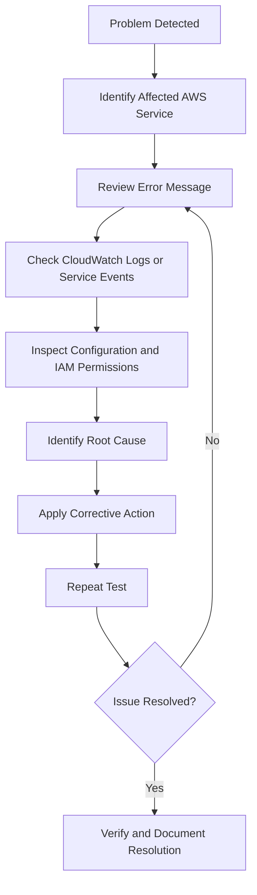

# AWS Automation, Serverless and Event-Driven Application – Troubleshooting Guide

## 1. Overview

This document describes common errors, troubleshooting procedures, and solutions encountered while implementing the AWS Automation, Serverless and Event-Driven Application project.

The purpose of this guide is to demonstrate practical troubleshooting skills across AWS services, including Lambda, S3, SQS, DynamoDB, API Gateway, EventBridge Scheduler, Systems Manager, CloudWatch, IAM, and Secrets Manager.

It also documents selected issues encountered during implementation and explains how they were resolved.

## 2. Troubleshooting Objectives

- Identify AWS service configuration errors.
- Understand Lambda execution failures.
- Diagnose IAM permission issues.
- Troubleshoot serverless integrations.
- Resolve API Gateway and Lambda errors.
- Diagnose EC2 automation failures.
- Verify Systems Manager connectivity.
- Troubleshoot CloudWatch alarms.
- Follow structured debugging practices.

## 3. Troubleshooting Workflow



## 4. AWS Lambda Troubleshooting

### Issue 1: Python Indentation Error

**Observed error:**

```text
IndentationError: unexpected indent
```

This type of error occurs when Python code has incorrect indentation.

**Possible causes:**
- Inconsistent indentation.
- Mixing tabs and spaces.
- Incorrectly nested statements.
- Incorrect placement of code blocks.

**Solution:**

1. Open the Lambda function.
2. Navigate to the Code section.
3. Review the affected line.
4. Correct the indentation.
5. Save and deploy the updated code.
6. Run the Lambda test again.

**Prevention:**

- Use consistent four-space indentation.
- Validate Python code before deployment.
- Keep code blocks properly structured.

### Issue 2: Lambda Execution Failure

Possible causes:
- Incorrect event structure.
- Missing IAM permissions.
- Invalid resource names.
- Incorrect AWS region.
- Application code errors.

**Troubleshooting commands and checks:**

Review the function's CloudWatch Logs and inspect the invocation error.

Check:
- Lambda execution role.
- Function configuration.
- Event payload.
- Environment configuration.
- Target AWS resource permissions.

## 5. Amazon S3 and Lambda Troubleshooting

### Issue 3: S3 Upload Does Not Trigger Lambda

Possible causes:
- S3 event notification not configured.
- Incorrect event type.
- Lambda invocation permission missing.
- Incorrect bucket or function selection.

**Solution:**

1. Open the S3 bucket.
2. Navigate to Properties.
3. Review Event notifications.
4. Confirm the object-created event configuration.
5. Check Lambda resource-based permissions.
6. Upload a test object.
7. Review Lambda invocation results.

**Verification:**

A successful workflow should retrieve the object, process its metadata, store a DynamoDB record, and publish the configured SNS notification.

## 6. DynamoDB Troubleshooting

### Issue 4: DynamoDB Record Not Created

Possible causes:
- Incorrect table name.
- Incorrect partition key.
- Missing `dynamodb:PutItem` permission.
- Incorrect item structure.
- Lambda execution failure.

**Solution:**

1. Open DynamoDB.
2. Select the target table.
3. Verify the partition key.
4. Review the Lambda execution role.
5. Inspect CloudWatch Logs.
6. Verify the item structure.
7. Run the test again.

### Important Design Consideration

The table uses `file_id` as its partition key.

Any application writing records must provide a valid `file_id` value.

## 7. Amazon SQS Troubleshooting

### Issue 5: SQS Messages Remain in the Queue

Possible causes:
- Lambda event source mapping is disabled.
- Lambda execution fails.
- Missing SQS permissions.
- Message body has an unexpected format.
- Visibility timeout and processing duration are unsuitable.

**Solution:**

1. Open the SQS queue.
2. Review message metrics.
3. Check the Lambda event source mapping.
4. Verify that the mapping is enabled.
5. Review Lambda CloudWatch Logs.
6. Check the Lambda execution role.
7. Validate the message JSON structure.

### Important SQS Behavior

Standard SQS queues provide at-least-once delivery.

A message may be delivered more than once. Applications should therefore use idempotent processing to prevent duplicate records or unintended repeated operations.

A dead-letter queue can also be configured to isolate messages that repeatedly fail processing.

## 8. API Gateway Troubleshooting

### Issue 6: API Gateway Returns HTTP 502

**Observed error:**

The API Gateway GET request initially returned an HTTP 502 error.

The Lambda logs showed:

```text
TypeError: Object of type Decimal is not JSON serializable
```

### Root Cause

DynamoDB returns numeric values through Python's `Decimal` type.

Python's standard `json.dumps()` cannot directly serialize Decimal objects.

As a result, Lambda failed while constructing the API response.

### Solution

A Decimal conversion helper was added to the API Lambda code.

```python
from decimal import Decimal

def decimal_converter(value):
    if isinstance(value, Decimal):
        if value % 1 == 0:
            return int(value)
        return float(value)

    raise TypeError(
        f"Object of type {type(value).__name__} "
        "is not JSON serializable"
    )
```

The response serialization was updated to use:

```python
json.dumps(response_data, default=decimal_converter)
```

The corrected implementation converts DynamoDB Decimal values into JSON-compatible numeric values.

### Verification

1. Save and deploy the Lambda function.
2. Invoke the GET endpoint again.
3. Review the Lambda execution logs.
4. Confirm the response is valid JSON.
5. Verify the API Gateway response status.

**Lesson learned:** When integrating DynamoDB with Python-based APIs, always account for DynamoDB's Decimal numeric representation.

## 9. API Gateway Deployment Troubleshooting

### Issue 7: API Changes Are Not Reflected

Possible causes:
- API changes were not deployed.
- Incorrect stage selected.
- Lambda integration configuration was not saved.
- Wrong invoke URL used.

**Solution:**

1. Open API Gateway.
2. Select the REST API.
3. Review the method and integration configuration.
4. Deploy the API to the `dev` stage.
5. Use the correct stage invoke URL.
6. Test GET and POST again.

## 10. EventBridge Scheduler Troubleshooting

### Issue 8: EC2 Start or Stop Schedule Does Not Work

Possible causes:
- Incorrect schedule target.
- Missing IAM execution role.
- Incorrect EC2 instance identifier.
- Incorrect trust policy.
- Insufficient EC2 API permissions.
- Incorrect schedule configuration.

**Solution:**

1. Open EventBridge Scheduler.
2. Select the relevant schedule.
3. Review the target service.
4. Verify the operation is `StartInstances` or `StopInstances`.
5. Check the execution role.
6. Review the IAM trust relationship.
7. Verify the target payload.
8. Check the EC2 instance state after execution.

### Example Target Input

```json
{
  "InstanceIds": [
    "YOUR_EC2_INSTANCE_ID"
  ]
}
```

Never publish actual EC2 instance IDs or account-specific IAM ARNs in public documentation.

### Important Consideration

The project uses recurring daily schedules.

Review their configuration carefully to avoid unexpected EC2 restarts or unnecessary running costs.

## 11. AWS Systems Manager Troubleshooting

### Issue 9: EC2 Instance Not Showing as Online

Possible causes:
- EC2 instance IAM role missing.
- `AmazonSSMManagedInstanceCore` policy not attached.
- SSM Agent stopped.
- Network connectivity unavailable.

**Solution:**

Check the agent:

```bash
sudo systemctl status amazon-ssm-agent
```

Verify:
- EC2 instance is running.
- Appropriate instance role is attached.
- Required Systems Manager policy is available.
- Agent is running.
- Required network connectivity is available.

### Issue 10: Run Command Fails

Possible causes:
- Incorrect command.
- Insufficient operating-system permissions.
- Agent communication problem.
- Package repository unavailable.

**Solution:**

1. Open Systems Manager.
2. Navigate to Run Command.
3. Select the failed command execution.
4. Review output and error details.
5. Verify the command syntax.
6. Check the SSM Agent.
7. Retry after correcting the issue.

## 12. CloudWatch Troubleshooting

### Issue 11: CloudWatch Alarm Does Not Enter ALARM State

Possible causes:
- CPU utilization did not exceed the threshold.
- Insufficient metric data.
- Incorrect metric dimensions.
- Evaluation criteria not satisfied.
- Incorrect EC2 instance selected.

**Solution:**

1. Open CloudWatch.
2. Navigate to All alarms.
3. Open `Yash-EC2-High-CPU-Alarm`.
4. Review the CPUUtilization metric.
5. Check the threshold and period.
6. Review alarm history.
7. Perform a controlled CPU test if appropriate.

### Issue 12: SNS Notification Not Received

Possible causes:
- SNS subscription not confirmed.
- Incorrect SNS topic configured.
- CloudWatch alarm action disabled.
- Notification delivery issue.

**Solution:**

1. Open Amazon SNS.
2. Select `Yash-EC2-CloudWatch-Alerts`.
3. Review subscriptions.
4. Verify subscription status.
5. Open the CloudWatch alarm.
6. Review notification actions.
7. Check alarm history and SNS delivery information.

## 13. IAM Troubleshooting

### Issue 13: AccessDenied Errors

Possible causes:
- Required IAM permission missing.
- Incorrect resource ARN.
- Incorrect trust policy.
- Explicit deny in another policy.
- KMS permission or key policy issue.

**Solution:**

1. Identify the IAM identity used by the AWS service.
2. Review attached policies.
3. Check the requested API action.
4. Verify the resource scope.
5. Review trust relationships where role assumption is involved.
6. Check KMS key policies when encryption permissions are involved.

**Best practice:** Grant only the permissions required for the specific workflow.

## 14. Secrets Manager Troubleshooting

### Issue 14: Secret Access Denied

Possible causes:
- Missing `secretsmanager:GetSecretValue`.
- Incorrect secret identifier.
- Incorrect region.
- KMS key permissions unavailable.

**Solution:**

- Verify the secret name.
- Check the IAM role.
- Review resource permissions.
- Check KMS access if a customer-managed key is used.

**Project-specific note:** The secret `Yash-Application-Secret` was created and verified as active, but Lambda retrieval was not implemented in this project. Therefore, Lambda secret-retrieval errors are general future-integration troubleshooting guidance, not an error encountered in the current implementation.

## 15. General Troubleshooting Best Practices

- Read the complete error message before changing configuration.
- Identify the AWS service responsible for the failure.
- Review CloudWatch Logs where applicable.
- Verify IAM permissions before changing application code.
- Check resource names and AWS region.
- Change one configuration at a time.
- Test after each corrective action.
- Document the root cause and solution.
- Avoid exposing credentials in logs or screenshots.
- Use controlled tests rather than making unnecessary production changes.

## 16. Actual Project Issues and Resolution Summary

The following table distinguishes reported implementation issues from general troubleshooting guidance.

| Issue | Root Cause | Resolution / Status |
|---|---|---|
| Lambda Python indentation error | Incorrect code indentation | Corrected Python indentation |
| API Gateway HTTP 502 | DynamoDB Decimal not JSON serializable | Added Decimal conversion helper |
| Systems Manager command execution | Required IAM and agent configuration | Run Command execution reported successful |
| EC2 start/stop automation | Scheduler and IAM role configuration | Both operations reported working |

Other troubleshooting topics in this document are preventive reference material, not claims that those failures occurred during deployment.

## 17. Final Project Outcome

This troubleshooting guide documents practical debugging methods across the AWS services used in the project.

It highlights the importance of reviewing service logs, understanding IAM permissions, validating event integrations, handling data-format differences, and testing corrective actions.

The documented examples demonstrate how structured troubleshooting helps maintain reliable AWS infrastructure and serverless applications.

## 18. Key Learning Outcomes

- Debugging Python Lambda functions.
- Understanding AWS service integration errors.
- Resolving DynamoDB Decimal serialization problems.
- Troubleshooting API Gateway responses.
- Reviewing IAM policies and role trust relationships.
- Diagnosing SQS message-processing issues.
- Troubleshooting EventBridge Scheduler.
- Verifying Systems Manager connectivity.
- Understanding CloudWatch alarm states.
- Improving AWS security and operational reliability.

---

**Project:** AWS Automation, Serverless and Event-Driven Application  
**AWS Region:** ap-northeast-3 (Asia Pacific – Osaka)  
**Documentation Section:** Troubleshooting and Issue Resolution  
**Author:** Yash Satyavan Jogdand  
**GitHub:** [yash-jogdand](https://github.com/yash-jogdand)
