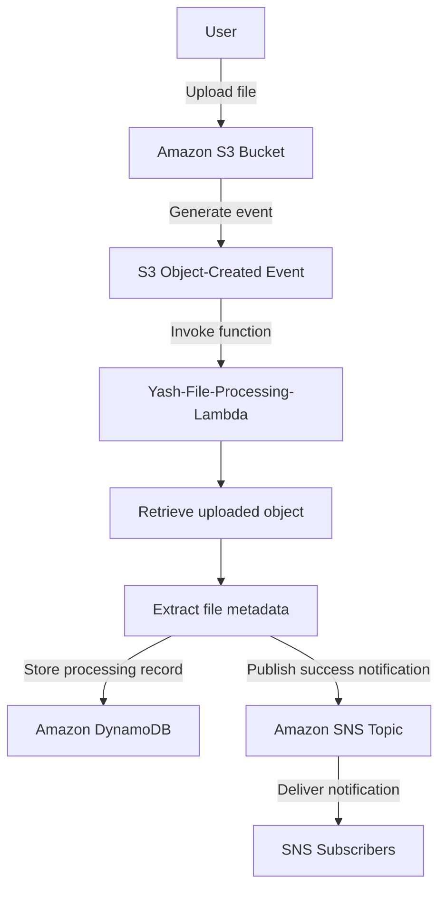

# S3 File Processing – Event-Driven Workflow

## 1. Overview

This workflow demonstrates automated file processing using Amazon S3, AWS Lambda, Amazon DynamoDB, and Amazon SNS.

Whenever a user uploads a file to the configured S3 bucket, an S3 event notification invokes the file-processing Lambda function. Lambda retrieves the uploaded object, extracts its metadata, stores processing information in DynamoDB, and publishes a notification through SNS.

This eliminates the need to manually monitor the bucket or process uploaded files.

## 2. AWS Services Used

| AWS Service | Resource | Purpose |
|---|---|---|
| Amazon S3 | `yash-serverless-file-processing-2026` | Stores uploaded files |
| S3 Event Notification | Object-created event | Triggers Lambda after an upload |
| AWS Lambda | `Yash-File-Processing-Lambda` | Processes uploaded files |
| Amazon DynamoDB | `Yash-FileProcessing-Table` | Stores file-processing information |
| Amazon SNS | `Yash-FileProcessing-Notifications` | Publishes processing notifications |
| AWS IAM | `Yash-Serverless-Lambda-Role` | Provides permissions to Lambda |

**AWS Region:** `ap-northeast-3` (Asia Pacific – Osaka)

## 3. Architecture Diagram



## 4. End-to-End Workflow

### Step 1 – Upload a file to S3

A user uploads a file to the configured Amazon S3 bucket.

Example:

- Bucket: `yash-serverless-file-processing-2026`
- Test file: `final-test.txt`

Amazon S3 stores the uploaded object.

### Step 2 – S3 Event Notification

The bucket is configured with an object-created event notification.

When a new object is uploaded, S3 generates an event containing information such as:

- Bucket name
- Object key
- Object details

The event notification invokes the configured Lambda function.

### Step 3 – Lambda Execution

The function `Yash-File-Processing-Lambda` receives the S3 event.

It uses the Boto3 SDK to interact with AWS services.

The function:

1. Reads the bucket name from the event.
2. Extracts the uploaded object's key.
3. Retrieves the object using the S3 `GetObject` operation.
4. Reads the file contents.
5. Calculates the file size.
6. Generates a processing timestamp.
7. Creates a processing record.

### Step 4 – Store Information in DynamoDB

Lambda stores the processing details in:

`Yash-FileProcessing-Table`

The record contains:

| Attribute | Description |
|---|---|
| `file_id` | Unique identifier based on bucket and object key |
| `file_name` | Uploaded file name |
| `bucket` | S3 bucket name |
| `object_key` | S3 object key |
| `file_size` | Size of the uploaded file in bytes |
| `status` | Processing status |
| `processed_at` | UTC processing timestamp |

Example record structure:

```json
{
  "file_id": "yash-serverless-file-processing-2026/final-test.txt",
  "file_name": "final-test.txt",
  "bucket": "yash-serverless-file-processing-2026",
  "object_key": "final-test.txt",
  "file_size": 120,
  "status": "Processed",
  "processed_at": "2026-11-10T10:30:00+00:00"
}
```

*The file size and timestamp above are illustrative examples, not a claim about the actual test file.*

### Step 5 – Publish SNS Notification

After storing the processing record, Lambda publishes a notification to:

`Yash-FileProcessing-Notifications`

The notification contains:

- Processing result
- Bucket name
- Uploaded filename
- File size
- Processing status

SNS distributes the notification to its configured subscribers.

## 5. Lambda Processing Logic

The following is the implementation logic used by the file-processing function.

```python
import json
import boto3
from urllib.parse import unquote_plus
from datetime import datetime, timezone

s3 = boto3.client('s3')
dynamodb = boto3.resource('dynamodb')
sns = boto3.client('sns')

table = dynamodb.Table('Yash-FileProcessing-Table')

SNS_TOPIC_ARN = 'YOUR_SNS_TOPIC_ARN'

def lambda_handler(event, context):
    for record in event['Records']:
        bucket = record['s3']['bucket']['name']
        key = unquote_plus(record['s3']['object']['key'])

        response = s3.get_object(
            Bucket=bucket,
            Key=key
        )

        file_content = response['Body'].read()
        file_name = key.split('/')[-1]
        file_id = f"{bucket}/{key}"

        table.put_item(
            Item={
                'file_id': file_id,
                'file_name': file_name,
                'bucket': bucket,
                'object_key': key,
                'file_size': len(file_content),
                'status': 'Processed',
                'processed_at': datetime.now(
                    timezone.utc
                ).isoformat()
            }
        )

        sns.publish(
            TopicArn=SNS_TOPIC_ARN,
            Subject='S3 File Processing Successful',
            Message=f"""
File processing completed successfully.

Bucket: {bucket}
File: {file_name}
Size: {len(file_content)} bytes
Status: Processed
"""
        )

        print(f"Successfully processed: {file_name}")

    return {
        'statusCode': 200,
        'body': json.dumps(
            'S3 files processed successfully'
        )
    }
```

**Configuration note:** Replace `YOUR_SNS_TOPIC_ARN` with the actual SNS topic ARN in your AWS environment before using this example. Never publish account credentials or secret values in this repository.

## 6. IAM Permissions

The Lambda execution role requires permissions for the operations performed by the function.

| Permission | Purpose |
|---|---|
| `s3:GetObject` | Reads uploaded objects |
| `dynamodb:PutItem` | Stores processing records |
| `sns:Publish` | Publishes SNS notifications |
| `logs:CreateLogGroup` | Creates the CloudWatch log group |
| `logs:CreateLogStream` | Creates log streams |
| `logs:PutLogEvents` | Writes Lambda execution logs |

The S3 event notification also needs permission to invoke the Lambda function.

The Lambda execution role and the S3-to-Lambda invocation permission serve different purposes.

## 7. Testing and Validation

The workflow was tested by uploading a file named `final-test.txt` to the S3 bucket.

The following results were reported during implementation:

| Validation | Expected result | Reported result |
|---|---|---|
| Upload test file | File appears in S3 | Successful |
| S3 event notification | Lambda is invoked | Successful |
| Lambda execution | File is processed | Successful |
| DynamoDB integration | Processing record is stored | Successful |
| SNS integration | Notification is published | Successful |

## 8. Monitoring and Troubleshooting

Lambda execution logs can be inspected through:

**AWS Console → CloudWatch → Log groups**

Locate:

`/aws/lambda/Yash-File-Processing-Lambda`

Common issues to investigate:

- Missing S3 event notification configuration.
- Lambda invocation permission missing from the function resource policy.
- Incorrect S3 object key or URL encoding.
- Missing `s3:GetObject` permission.
- Missing DynamoDB `PutItem` permission.
- Missing SNS `Publish` permission.
- Incorrect SNS topic ARN.
- Lambda execution errors.

## 9. Important Design Considerations

- S3 event notifications provide asynchronous event delivery.
- S3 event notifications can deliver duplicate events, so production systems should consider idempotent processing.
- Large files may require streaming or partial processing instead of reading the entire object into memory.
- Failed Lambda executions should be monitored and handled through an appropriate retry and failure-handling strategy.
- SNS delivery depends on the configured subscription type and its confirmation status.

## 10. Conclusion

This workflow demonstrates an event-driven serverless file-processing architecture using AWS-managed services.

It connects object storage, serverless compute, NoSQL database storage, and notification services into one automated workflow.

The implementation provides practical experience with S3 event notifications, Lambda execution, Boto3, DynamoDB integration, SNS publishing, and IAM permissions.
