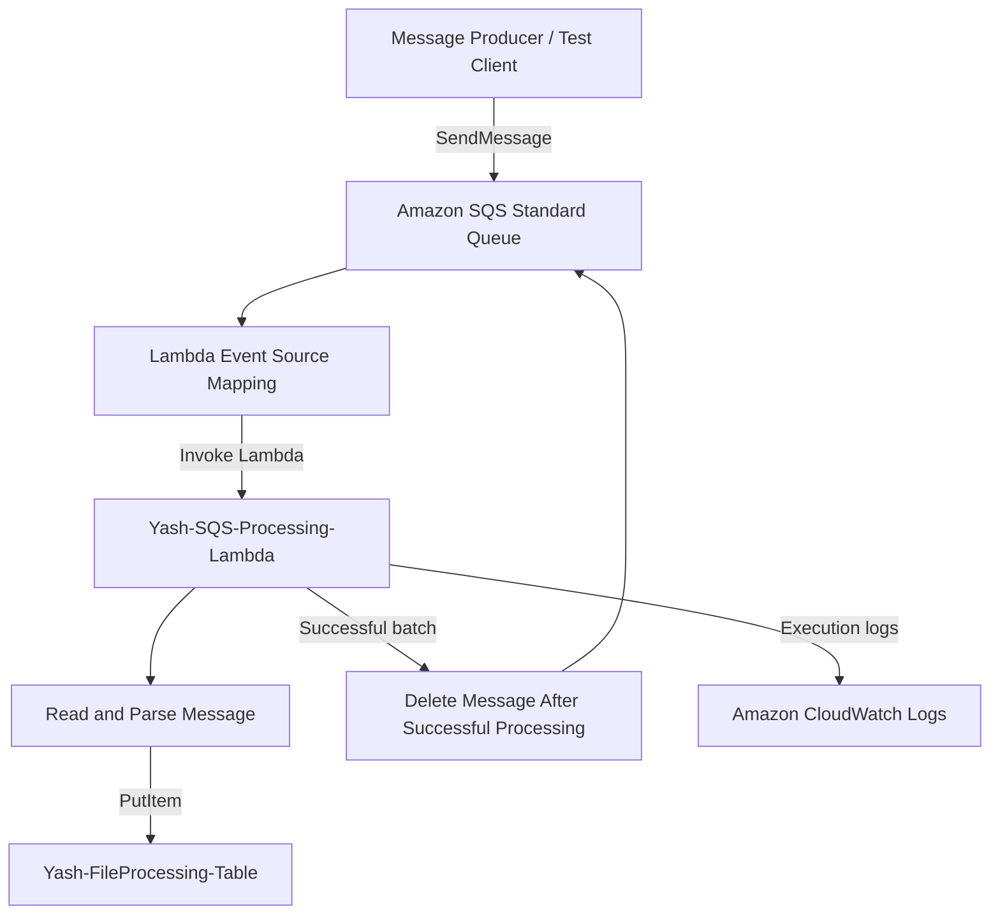

# Amazon SQS – Asynchronous Message Processing Workflow

## 1. Overview

This workflow demonstrates asynchronous message processing using Amazon Simple Queue Service (SQS), AWS Lambda, and Amazon DynamoDB.

Instead of processing messages immediately within the producer application, messages are placed into an SQS queue. A dedicated Lambda function processes messages received from the queue and stores the resulting information in DynamoDB.

This architecture reduces direct dependencies between application components and supports reliable asynchronous processing.

## 2. AWS Services Used

| AWS Service | Resource | Responsibility |
|---|---|---|
| Amazon SQS | `Yash-FileProcessing-Queue` | Stores messages until they are processed |
| AWS Lambda | `Yash-SQS-Processing-Lambda` | Processes messages received from SQS |
| Amazon DynamoDB | `Yash-FileProcessing-Table` | Stores processed message information |
| AWS IAM | `Yash-Serverless-Lambda-Role` | Provides execution permissions |

**AWS Region:** `ap-northeast-3` (Asia Pacific – Osaka)

## 3. Architecture Diagram



## 4. End-to-End Workflow

### Step 1 – Create the SQS Queue

An Amazon SQS Standard queue is configured with the following settings:

| Setting | Configuration |
|---|---|
| Queue name | `Yash-FileProcessing-Queue` |
| Queue type | Standard |
| Visibility timeout | 30 seconds |
| Message retention | 4 days |
| Delivery delay | 0 seconds |
| Long polling | 0 seconds |
| Encryption | SSE-SQS |

The queue temporarily stores messages until they are consumed by the Lambda function.

### Step 2 – Send a Message

A producer or test client sends a JSON message to the SQS queue.

Example:

```json
{
  "file_id": "103",
  "file_name": "sqs-final-test.txt",
  "status": "Pending"
}
```

SQS stores the message until it is received and processed.

### Step 3 – Configure Lambda Integration

The dedicated Lambda function is:

`Yash-SQS-Processing-Lambda`

An SQS event source mapping connects the queue to the Lambda function.

The integration works as follows:

1. Lambda polls the configured SQS queue.
2. Available messages are retrieved.
3. Lambda receives an event containing the message records.
4. The function processes the message body.
5. Successful processing allows the event source mapping to delete the messages.

### Step 4 – Process the Message

The Lambda function extracts the JSON message body and reads:

- File ID
- File name
- Processing status

It then stores these attributes in DynamoDB.

### Step 5 – Store the Record in DynamoDB

The destination table is:

`Yash-FileProcessing-Table`

Example record:

```json
{
  "file_id": "103",
  "file_name": "sqs-final-test.txt",
  "status": "Pending"
}
```

### Step 6 – Delete the Successfully Processed Message

When Lambda successfully processes a message, the SQS event source mapping deletes the message from the queue.

This prevents successfully processed messages from remaining available for normal processing.

If processing fails, the message can become visible again after the visibility timeout and may be retried.

## 5. Lambda Implementation

The following Python code represents the SQS processing Lambda function.

```python
import json
import boto3

dynamodb = boto3.resource('dynamodb')

table = dynamodb.Table('Yash-FileProcessing-Table')

def lambda_handler(event, context):

    for record in event['Records']:

        message = json.loads(record['body'])

        table.put_item(
            Item={
                'file_id': message['file_id'],
                'file_name': message['file_name'],
                'status': message['status']
            }
        )

    return {
        'statusCode': 200
    }
```

The function uses Boto3 to interact with DynamoDB.

The Lambda function receives the SQS message through the event source mapping. It does not need to manually call `ReceiveMessage` or `DeleteMessage` in this implementation.

## 6. IAM Permissions

The Lambda execution role requires the following permissions:

| IAM Permission | Purpose |
|---|---|
| `sqs:ReceiveMessage` | Receives messages |
| `sqs:DeleteMessage` | Deletes successfully processed messages |
| `sqs:GetQueueAttributes` | Reads queue attributes |
| `sqs:ChangeMessageVisibility` | Changes message visibility when required |
| `dynamodb:PutItem` | Stores message information |
| `logs:CreateLogGroup` | Creates a log group |
| `logs:CreateLogStream` | Creates log streams |
| `logs:PutLogEvents` | Writes execution logs |

These permissions should be restricted to the required queue and DynamoDB table wherever possible.

## 7. Testing and Validation

A test message was prepared and submitted to the SQS queue.

Example test:

```json
{
  "file_id": "103",
  "file_name": "sqs-final-test.txt",
  "status": "Pending"
}
```

The expected validation results are:

| Validation | Expected result |
|---|---|
| Message submission | Message appears in SQS |
| Lambda event source mapping | Lambda receives the message |
| JSON processing | Message fields are extracted |
| DynamoDB integration | Record is stored |
| Message acknowledgement | Successfully processed message is deleted |

**Validation note:** Confirm the actual successful queue-to-DynamoDB test before presenting every result as independently verified.

## 8. Monitoring and Troubleshooting

Lambda logs can be reviewed in:

**AWS Console → CloudWatch → Log groups**

Log group:

`/aws/lambda/Yash-SQS-Processing-Lambda`

Common issues include:

- Event source mapping disabled.
- Incorrect queue ARN.
- Missing SQS permissions.
- Missing DynamoDB `PutItem` permission.
- Invalid JSON message body.
- Message visibility timeout too short for processing.
- Lambda execution failures.
- Messages repeatedly returning to the queue.

For production systems, configure a dead-letter queue (DLQ), appropriate retry behavior, and partial batch failure reporting where needed.

## 9. Important Design Considerations

- SQS Standard queues provide at-least-once message delivery.
- Duplicate message processing is possible.
- Application processing should be idempotent.
- Visibility timeout should be appropriate for the Lambda execution duration.
- Failed messages should be monitored.
- A dead-letter queue can help isolate messages that repeatedly fail.
- Successful processing and deletion are handled by the Lambda event source mapping.

## 10. Conclusion

This workflow demonstrates asynchronous message processing using Amazon SQS, AWS Lambda, and DynamoDB.

It provides practical experience with message queues, Lambda event source mappings, JSON processing, database integration, IAM permissions, and reliable event-driven application design.
