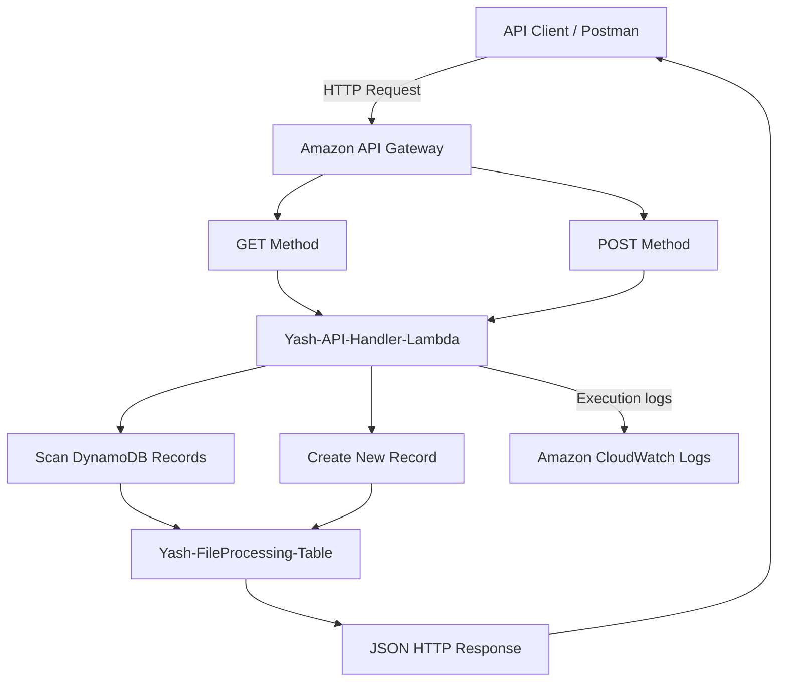

# API Gateway – REST API Integration with Lambda and DynamoDB

## 1. Overview

This workflow demonstrates the development of a REST API using Amazon API Gateway, AWS Lambda, and Amazon DynamoDB.

API Gateway acts as the entry point for HTTP requests. It forwards requests to a dedicated Lambda function, which processes the request and interacts with DynamoDB.

The application supports two HTTP methods:

- **POST:** Creates a new application record.
- **GET:** Retrieves existing application records.

This architecture demonstrates serverless API development without managing an application server.

## 2. AWS Services Used

| AWS Service | Resource | Responsibility |
|---|---|---|
| Amazon API Gateway | `Yash-Serverless-REST-API` | Exposes REST API endpoints |
| AWS Lambda | `Yash-API-Handler-Lambda` | Handles API requests |
| Amazon DynamoDB | `Yash-FileProcessing-Table` | Stores and retrieves records |
| AWS IAM | `Yash-Serverless-Lambda-Role` | Provides Lambda execution permissions |
| Amazon CloudWatch | Lambda log group | Stores execution logs |

**AWS Region:** `ap-northeast-3` (Asia Pacific – Osaka)

## 3. Architecture Diagram



## 4. API Configuration

The API Gateway resource is configured with the following details:

| Setting | Configuration |
|---|---|
| API name | `Yash-Serverless-REST-API` |
| API type | REST API |
| Endpoint type | Regional |
| Stage | `dev` |
| HTTP methods | GET and POST |
| Integration | AWS Lambda |
| Lambda function | `Yash-API-Handler-Lambda` |

### API Invoke URL

```text
https://q555bidw9k.execute-api.ap-northeast-3.amazonaws.com/dev
```

This is the base invoke URL for the deployed `dev` stage.

The resource path and HTTP methods are configured under the API Gateway resources.

## 5. GET Request – Retrieve Records

The GET method retrieves records from DynamoDB.

### Request

```http
GET /dev
```

### Processing Flow

1. The API client sends a GET request.
2. API Gateway invokes the API Lambda function.
3. Lambda identifies the HTTP method as GET.
4. Lambda executes a DynamoDB Scan operation.
5. DynamoDB returns matching table records.
6. Lambda converts the response into JSON.
7. API Gateway returns the HTTP response to the client.

### Expected Response

HTTP status:

```text
200 OK
```

Example response:

```json
[
  {
    "file_id": "103",
    "file_name": "sqs-final-test.txt",
    "status": "Pending"
  }
]
```

The response contents depend on the records currently stored in DynamoDB.

## 6. POST Request – Create a Record

The POST method creates a new application record in DynamoDB.

### Request

```http
POST /dev
```

### Request Body

```json
{
  "file_name": "api-test-file.txt"
}
```

### Processing Flow

1. The API client sends a POST request with a JSON body.
2. API Gateway invokes the API Lambda function.
3. Lambda identifies the HTTP method as POST.
4. Lambda parses the JSON request body.
5. A unique file ID is generated using Python UUID.
6. A creation timestamp is generated.
7. Lambda stores the new record in DynamoDB.
8. Lambda returns a JSON response.

### Expected Response

HTTP status:

```text
201 Created
```

Example response:

```json
{
  "file_id": "generated-uuid",
  "file_name": "api-test-file.txt",
  "status": "Created",
  "created_at": "2026-11-10T10:30:00+00:00"
}
```

The UUID and timestamp above are illustrative examples.

## 7. Lambda Implementation

The following Python implementation handles both GET and POST requests.

```python
import json
import boto3
import uuid
from decimal import Decimal
from datetime import datetime, timezone

dynamodb = boto3.resource('dynamodb')
table = dynamodb.Table('Yash-FileProcessing-Table')

def decimal_converter(value):
    if isinstance(value, Decimal):
        if value % 1 == 0:
            return int(value)
        return float(value)

    raise TypeError(
        f"Type {type(value).__name__} not serializable"
    )

def lambda_handler(event, context):

    method = event.get('httpMethod', '')

    if method == 'GET':

        response = table.scan()

        return {
            'statusCode': 200,
            'headers': {
                'Content-Type': 'application/json'
            },
            'body': json.dumps(
                response['Items'],
                default=decimal_converter
            )
        }

    elif method == 'POST':

        body = json.loads(event.get('body') or '{}')

        item = {
            'file_id': str(uuid.uuid4()),
            'file_name': body.get(
                'file_name',
                'unknown'
            ),
            'status': 'Created',
            'created_at': datetime.now(
                timezone.utc
            ).isoformat()
        }

        table.put_item(Item=item)

        return {
            'statusCode': 201,
            'headers': {
                'Content-Type': 'application/json'
            },
            'body': json.dumps(item)
        }

    return {
        'statusCode': 400,
        'headers': {
            'Content-Type': 'application/json'
        },
        'body': json.dumps({
            'message': 'Unsupported HTTP method'
        })
    }
```

## 8. API Gateway Lambda Integration

The REST API uses Lambda integration to forward HTTP requests to the backend function.

The integration must provide the HTTP method to Lambda through the event payload.

For this implementation, the Lambda function expects the API Gateway REST API proxy event format, including:

- `httpMethod`
- `body`

The GET and POST methods must be integrated with the correct Lambda function.

After modifying an API Gateway REST API method or integration, deploy the API again to the `dev` stage for the changes to become available through the invoke URL.

## 9. IAM Permissions

The Lambda execution role requires the following permissions:

| Permission | Purpose |
|---|---|
| `dynamodb:Scan` | Retrieves records |
| `dynamodb:PutItem` | Creates new records |
| `logs:CreateLogGroup` | Creates a log group |
| `logs:CreateLogStream` | Creates log streams |
| `logs:PutLogEvents` | Writes execution logs |

These permissions should be scoped to the project DynamoDB table and required CloudWatch log resources wherever possible.

API Gateway also requires permission to invoke the Lambda function. This is handled through the Lambda resource-based permission configuration.

## 10. Testing and Validation

The API can be tested using Postman or another HTTP client.

### GET Test

1. Select GET.
2. Enter the deployed API invoke URL.
3. Send the request.
4. Review the returned records.

Expected HTTP response:

```text
200 OK
```

### POST Test

1. Select POST.
2. Enter the deployed API invoke URL.
3. Select Body → raw → JSON.
4. Enter:

```json
{
  "file_name": "api-test-file.txt"
}
```

5. Send the request.
6. Review the response and confirm the new record exists in DynamoDB.

Expected HTTP response:

```text
201 Created
```

### Validation Checklist

| Validation | Expected result |
|---|---|
| API Gateway deployment | `dev` stage available |
| GET request | Returns HTTP 200 |
| POST request | Returns HTTP 201 |
| DynamoDB integration | New record is stored |
| JSON response | Valid JSON is returned |
| CloudWatch logs | Lambda execution details available |

## 11. Troubleshooting – API Gateway 502 Error

During implementation, the GET API encountered a Lambda execution error:

```text
TypeError: Object of type Decimal is not JSON serializable
```

### Root Cause

DynamoDB's Python SDK can return numeric attributes as Python `Decimal` objects.

Python's default `json.dumps()` does not serialize Decimal values automatically.

This caused Lambda execution to fail while constructing the API response, resulting in an API Gateway 502 response.

### Solution

A custom `decimal_converter()` function was added.

It converts:

- Whole-number Decimal values into integers.
- Fractional Decimal values into floating-point numbers.

The GET method then uses:

```python
json.dumps(
    response['Items'],
    default=decimal_converter
)
```

This resolved the JSON serialization issue in the implementation.

## 12. Important Design Considerations

- API Gateway provides a managed HTTP entry point.
- Lambda handles application logic without server management.
- DynamoDB provides managed NoSQL storage.
- GET uses Scan, which reads the table and may become expensive for larger datasets.
- Production applications should consider Query operations, pagination, validation, authentication, throttling, and appropriate error handling.
- POST requests should validate input before storing records.
- API Gateway deployments must be updated when integration changes are made.

## 13. Conclusion

This workflow demonstrates how to develop a serverless REST API using Amazon API Gateway, AWS Lambda, and DynamoDB.

It provides practical experience with HTTP methods, Lambda proxy integration, JSON request handling, DynamoDB operations, HTTP response codes, CloudWatch logging, and troubleshooting API Gateway errors.
