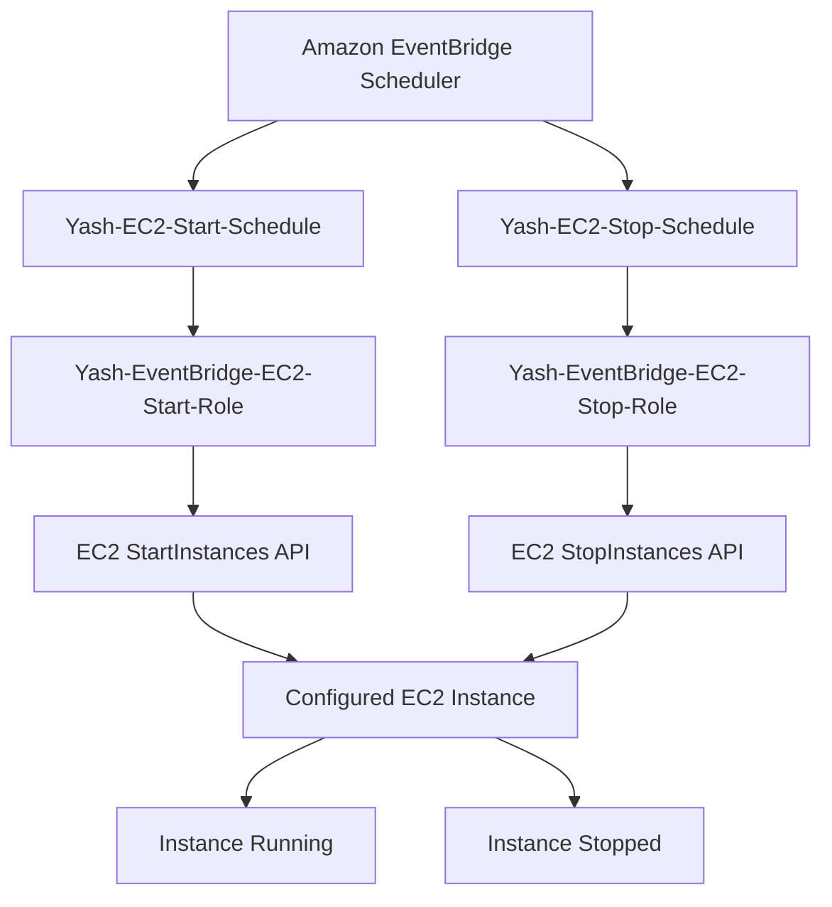

# EventBridge Scheduler – Automated EC2 Start and Stop

## 1. Overview

This component uses **Amazon EventBridge Scheduler** to automate the starting and stopping of an Amazon EC2 instance.

Instead of manually starting or stopping the instance through the AWS Management Console, EventBridge Scheduler invokes the corresponding EC2 API operation using an IAM execution role.

Two independent schedules are configured:

- `Yash-EC2-Start-Schedule` – starts the configured EC2 instance.
- `Yash-EC2-Stop-Schedule` – stops the configured EC2 instance.

Both schedules use the `rate(1 day)` schedule expression.

**Important:** A daily rate expression repeats every 24 hours. It does not mean a specific clock time such as 9:00 AM. The actual execution timing depends on the schedule configuration and its start time.

## 2. AWS Services Used

| AWS service | Purpose |
|---|---|
| Amazon EventBridge Scheduler | Executes scheduled EC2 operations |
| Amazon EC2 | Provides the instance being started and stopped |
| AWS IAM | Grants Scheduler permission to invoke EC2 APIs |
| AWS CloudTrail | Can be used to investigate recorded API activity |

## 3. Architecture

The project uses two schedules with separate IAM execution roles. Each role grants permission for only its intended EC2 operation.



## 4. Configured AWS Resources

| Resource | Name | Purpose |
|---|---|---|
| Start schedule | `Yash-EC2-Start-Schedule` | Starts the EC2 instance |
| Stop schedule | `Yash-EC2-Stop-Schedule` | Stops the EC2 instance |
| Start execution role | `Yash-EventBridge-EC2-Start-Role` | Allows the start operation |
| Stop execution role | `Yash-EventBridge-EC2-Stop-Role` | Allows the stop operation |
| Target service | Amazon EC2 | Receives the API request |
| Schedule expression | `rate(1 day)` | Repeats every 24 hours |

The actual EC2 instance ID is intentionally not published in this repository.

## 5. IAM Execution Roles

EventBridge Scheduler needs permission to assume an IAM role before invoking the target AWS service.

Two separate roles were created to keep the permissions for starting and stopping the instance independent.

### 5.1 Trust policy

The trust relationship allows the EventBridge Scheduler service to assume the role.

Example trust policy:

```json
{
  "Version": "2012-10-17",
  "Statement": [
    {
      "Effect": "Allow",
      "Principal": {
        "Service": "scheduler.amazonaws.com"
      },
      "Action": "sts:AssumeRole"
    }
  ]
}
```

This trust policy is used by the Scheduler execution roles.

### 5.2 Start role permission policy

The start role requires the `ec2:StartInstances` permission.

Example policy:

```json
{
  "Version": "2012-10-17",
  "Statement": [
    {
      "Effect": "Allow",
      "Action": "ec2:StartInstances",
      "Resource": "arn:aws:ec2:ap-northeast-3:YOUR_ACCOUNT_ID:instance/YOUR_EC2_INSTANCE_ID"
    }
  ]
}
```

Replace the placeholders with the appropriate values when configuring the policy in AWS. Do not commit your actual account ID or instance ID to this public repository.

### 5.3 Stop role permission policy

The stop role requires the `ec2:StopInstances` permission.

Example policy:

```json
{
  "Version": "2012-10-17",
  "Statement": [
    {
      "Effect": "Allow",
      "Action": "ec2:StopInstances",
      "Resource": "arn:aws:ec2:ap-northeast-3:YOUR_ACCOUNT_ID:instance/YOUR_EC2_INSTANCE_ID"
    }
  ]
}
```

The resource should be restricted to the intended EC2 instance rather than granting access to every instance in the account.

## 6. EventBridge Scheduler Configuration

### 6.1 EC2 start schedule

The start schedule uses the following configuration:

| Setting | Configuration |
|---|---|
| Schedule name | `Yash-EC2-Start-Schedule` |
| Schedule type | Recurring |
| Schedule expression | `rate(1 day)` |
| Target service | Amazon EC2 |
| Target API operation | `StartInstances` |
| Execution role | `Yash-EventBridge-EC2-Start-Role` |
| Input | Configured EC2 instance ID |

Target input example:

```json
{
  "InstanceIds": [
    "YOUR_EC2_INSTANCE_ID"
  ]
}
```

When the schedule runs, EventBridge Scheduler assumes the start execution role and calls the EC2 `StartInstances` API.

### 6.2 EC2 stop schedule

The stop schedule uses a separate execution role and the EC2 `StopInstances` API.

| Setting | Configuration |
|---|---|
| Schedule name | `Yash-EC2-Stop-Schedule` |
| Schedule type | Recurring |
| Schedule expression | `rate(1 day)` |
| Target service | Amazon EC2 |
| Target API operation | `StopInstances` |
| Execution role | `Yash-EventBridge-EC2-Stop-Role` |
| Input | Configured EC2 instance ID |

Target input example:

```json
{
  "InstanceIds": [
    "YOUR_EC2_INSTANCE_ID"
  ]
}
```

When the schedule runs, EventBridge Scheduler assumes the stop execution role and calls the EC2 `StopInstances` API.

## 7. Execution Workflow

### Start workflow

1. EventBridge Scheduler reaches the configured execution time.
2. The start schedule is triggered.
3. Scheduler assumes `Yash-EventBridge-EC2-Start-Role`.
4. AWS IAM validates the role permissions.
5. Scheduler invokes the EC2 `StartInstances` API.
6. EC2 begins starting the configured instance.
7. The instance transitions toward the `running` state.

### Stop workflow

1. EventBridge Scheduler reaches the configured execution time.
2. The stop schedule is triggered.
3. Scheduler assumes `Yash-EventBridge-EC2-Stop-Role`.
4. AWS IAM validates the role permissions.
5. Scheduler invokes the EC2 `StopInstances` API.
6. EC2 begins stopping the configured instance.
7. The instance transitions toward the `stopped` state.

## 8. Validation and Testing

The start and stop automation was tested during implementation, and the user reported that both operations worked.

The following checks are useful when validating the configuration again:

| Validation | Expected result |
|---|---|
| Start schedule exists | Schedule is present in EventBridge Scheduler |
| Stop schedule exists | Schedule is present in EventBridge Scheduler |
| Start execution role exists | IAM role is available |
| Stop execution role exists | IAM role is available |
| Start role trust policy | Allows `scheduler.amazonaws.com` to assume the role |
| Stop role trust policy | Allows `scheduler.amazonaws.com` to assume the role |
| Start permission | Scoped `ec2:StartInstances` permission |
| Stop permission | Scoped `ec2:StopInstances` permission |
| Start operation | EC2 transitions to `running` |
| Stop operation | EC2 transitions to `stopped` |

The EC2 instance state can be checked from the EC2 console under **Instances → Instance state**.

CloudTrail can also help investigate the `StartInstances` and `StopInstances` API activity.

## 9. Security Best Practices

- Use separate IAM execution roles for start and stop operations.
- Restrict each role to its required EC2 API action.
- Scope the resource ARN to the intended EC2 instance.
- Allow only the EventBridge Scheduler service to assume these roles.
- Do not publish account IDs, instance IDs, or sensitive configuration in public documentation.
- Review IAM permissions periodically.
- Monitor schedule execution and investigate failed invocations.

## 10. Important Cost and Operational Considerations

EC2 automation can reduce compute costs when instances are not needed continuously. However, a schedule configured with `rate(1 day)` continues to repeat every 24 hours.

Keep these points in mind:

1. Verify the start and stop schedules' actual execution times. Do not assume that one runs before the other.
2. A stop schedule can interrupt an application, deployment, or active workload.
3. A start schedule can restart an instance that was intentionally stopped.
4. Stopping an EC2 instance does not automatically eliminate every associated charge. EBS volumes, snapshots, Elastic IP configurations, and other resources may still incur costs.
5. Review or disable the schedules when they are no longer needed for the project demonstration.
6. Check the EC2 instance state after important schedule executions.

## 11. Troubleshooting

| Problem | Possible reason | What to check |
|---|---|---|
| Schedule does not execute | Schedule disabled or incorrectly configured | Schedule state and expression |
| Access denied | Missing IAM permission | Execution role permission policy |
| Scheduler cannot assume role | Incorrect trust relationship | Scheduler service principal |
| EC2 does not start | Incorrect instance ID or invalid instance state | Target input and EC2 state |
| EC2 does not stop | Missing `ec2:StopInstances` permission | Stop execution role |
| Unexpected start or stop | Recurring schedule still enabled | Schedule expression and state |
| Schedule runs but operation fails | Target API or IAM configuration issue | Scheduler execution details and CloudTrail |

## 12. Learning Outcomes

Through this implementation, the project demonstrates:

- Automating EC2 operations using EventBridge Scheduler.
- Understanding recurring schedule expressions.
- Integrating EventBridge Scheduler directly with AWS service APIs.
- Creating IAM trust policies for service-to-role access.
- Applying least-privilege permissions to EC2 operations.
- Separating start and stop permissions through dedicated execution roles.
- Understanding operational risks and cost considerations of scheduled infrastructure automation.

## 13. Project Status

| Component | Status |
|---|---|
| EventBridge start schedule | Configured |
| EventBridge stop schedule | Configured |
| Start execution IAM role | Configured |
| Stop execution IAM role | Configured |
| EC2 start operation | Tested successfully and reported working |
| EC2 stop operation | Tested successfully and reported working |
| Documentation | Completed |

---

**Region:** Asia Pacific (Osaka) – `ap-northeast-3`

**Project:** AWS Automation, Serverless and Event-Driven Application

**Author:** Yash Satyavan Jogdand
