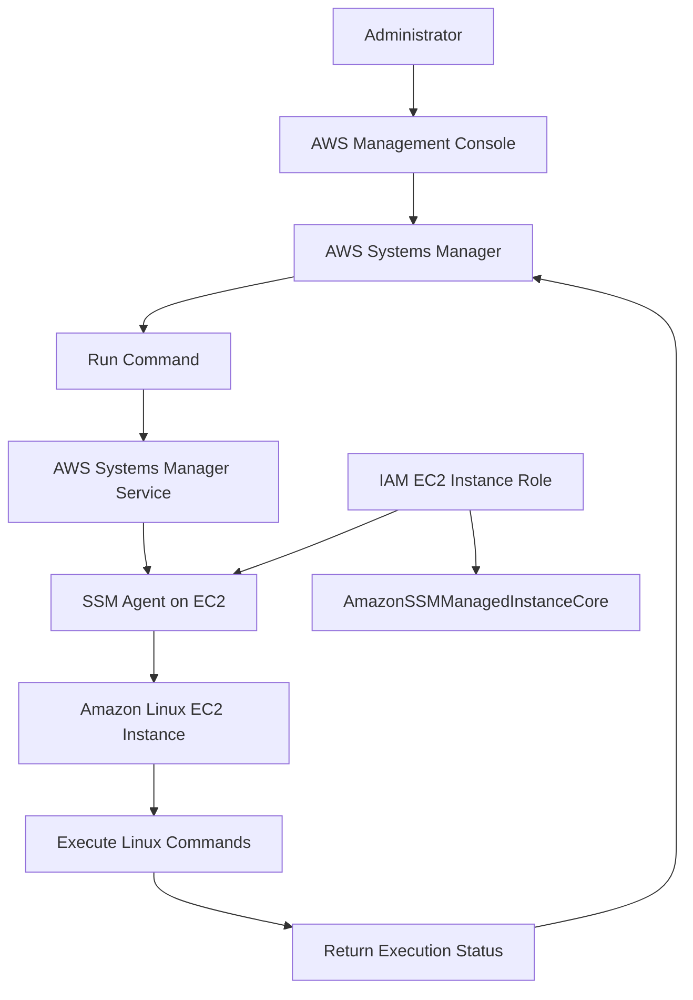
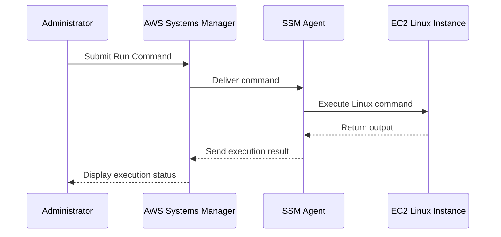

# AWS Systems Manager – EC2 Management and Run Command

## 1. Overview

AWS Systems Manager (SSM) is an AWS service that helps administrators manage, monitor, and operate EC2 instances and other AWS resources.

In this project, AWS Systems Manager was configured to manage an EC2 instance using the Systems Manager Agent (SSM Agent) and an IAM instance role.

The project uses Systems Manager Run Command to execute administrative commands remotely without requiring a direct SSH connection for every management task.

### Objectives

- Configure an IAM role for Systems Manager access.
- Attach the required IAM role to the EC2 instance.
- Allow the SSM Agent to communicate with AWS Systems Manager.
- Verify that the EC2 instance is registered as a managed node.
- Execute Linux commands using Run Command.
- Monitor command execution status.

## 2. AWS Services Used

| Service | Purpose |
|---|---|
| Amazon EC2 | Hosts the Linux instance |
| AWS Systems Manager | Provides centralized instance management |
| SSM Agent | Communicates between EC2 and Systems Manager |
| AWS IAM | Provides permissions to the EC2 instance |
| Systems Manager Run Command | Executes commands remotely |
| Amazon CloudWatch | Supports operational monitoring and logging where configured |

## 3. Architecture Diagram



## 4. IAM Configuration

An IAM role was created and attached to the EC2 instance to allow it to communicate with AWS Systems Manager.

### IAM Role

The EC2 instance role includes the AWS managed policy:

`AmazonSSMManagedInstanceCore`

This policy provides the permissions required for core Systems Manager functionality.

### Why is this policy required?

The EC2 instance needs permission to:

- Register with Systems Manager.
- Communicate with Systems Manager endpoints.
- Receive management instructions.
- Send command execution results.
- Report managed-instance information.

**Security note:** The instance role should be attached directly to the EC2 instance through its instance profile. Avoid storing long-term AWS access keys on the server.

## 5. Systems Manager Agent

The Systems Manager Agent (SSM Agent) runs on the EC2 instance and communicates with AWS Systems Manager.

For the instance to be managed successfully:

1. The EC2 instance must be running.
2. The SSM Agent must be installed and running.
3. The EC2 instance must have an appropriate IAM role.
4. The instance must have network connectivity to the required Systems Manager endpoints.

### Check SSM Agent Status

The following Linux command checks the agent status:

```bash
sudo systemctl status amazon-ssm-agent
```

Expected result: the service should show an active and running state.

## 6. Managed Node Verification

After configuring the IAM role and SSM Agent, the EC2 instance can be checked through the Systems Manager console.

Navigation:

1. Open AWS Management Console.
2. Search for **Systems Manager**.
3. Open Systems Manager.
4. Navigate to **Fleet Manager**.
5. Open Managed nodes.
6. Locate the EC2 instance.
7. Verify that its connection status is Online.

A managed node appearing Online indicates that Systems Manager can communicate with the instance.

## 7. Run Command Configuration

Run Command allows administrators to execute commands on managed instances without manually opening an SSH session.

### Procedure

1. Open AWS Systems Manager.
2. Navigate to **Run Command** under Node Management.
3. Select **Run command**.
4. Search for the document:

   `AWS-RunShellScript`

5. Select the document.
6. Under Targets, choose the managed EC2 instance.
7. Enter the commands.
8. Select **Run**.
9. Open the command execution details.
10. Verify the overall status and individual instance status.

### Commands Executed

The following commands were used for the project:

```bash
sudo yum update -y
sudo systemctl status amazon-ssm-agent
```

**Command 1 – Update Linux packages**

```bash
sudo yum update -y
```

This command updates installed packages using the configured package repositories.

**Command 2 – Check SSM Agent**

```bash
sudo systemctl status amazon-ssm-agent
```

This verifies whether the Systems Manager Agent is running.

## 8. Run Command Execution Flow



## 9. Validation and Testing

The following checks were performed during implementation.

| Validation | Expected Result | Project Status |
|---|---|---|
| IAM role attached to EC2 | Role associated with instance | Configured |
| AmazonSSMManagedInstanceCore policy | Policy attached to role | Configured |
| SSM Agent status | Active and running | Verified |
| Managed node registration | Instance visible in Fleet Manager | Verified |
| Managed node connection | Online | Verified |
| Run Command execution | Command completes successfully | Verified |

The Run Command execution was reported successful during implementation.

## 10. Troubleshooting

### Issue 1: EC2 Instance Not Appearing in Managed Nodes

**Possible causes:**
- IAM role is missing.
- Required IAM policy is not attached.
- SSM Agent is stopped.
- Network connectivity to Systems Manager endpoints is unavailable.

**Checks:**

```bash
sudo systemctl status amazon-ssm-agent
```

Review the EC2 instance role and network connectivity.

### Issue 2: Managed Node Shows Offline

**Possible causes:**
- EC2 instance is stopped.
- SSM Agent is not running.
- Instance cannot reach the Systems Manager endpoints.
- IAM permissions are insufficient.

**Recommended actions:**
1. Verify EC2 instance state.
2. Check the attached IAM role.
3. Check the SSM Agent.
4. Verify outbound connectivity or the required VPC endpoints.

### Issue 3: Run Command Execution Failed

**Possible causes:**
- Incorrect command syntax.
- Insufficient Linux permissions.
- Package repository connectivity issues.
- SSM Agent communication problems.

**Recommended actions:**
- Review command output and error messages.
- Check the command document and target selection.
- Verify the SSM Agent status.
- Retry only after identifying the cause.

## 11. Security Best Practices

- Follow the principle of least privilege for IAM roles.
- Do not store AWS access keys on EC2 instances.
- Restrict who can execute Run Command.
- Use Systems Manager logging and auditing capabilities where appropriate.
- Review command execution history.
- Use VPC endpoints when private connectivity to Systems Manager is required and supported by the network design.
- Avoid executing unreviewed commands on production instances.

## 12. Benefits of AWS Systems Manager

- Centralized EC2 administration.
- Remote command execution.
- Reduced dependency on direct SSH access.
- Improved operational visibility.
- Easier Linux maintenance.
- IAM-based access control.
- Better support for managing multiple EC2 instances.

## 13. Project Outcome

AWS Systems Manager was configured to manage the EC2 instance through an IAM instance role and the SSM Agent.

The instance was verified as an Online managed node, and Run Command was used to execute Linux maintenance and agent-status commands successfully.

This implementation demonstrates the use of AWS Systems Manager for remote EC2 administration and basic operational maintenance.

## 14. Important Notes

- Systems Manager does not automatically replace every SSH use case.
- The EC2 instance still requires suitable network connectivity to Systems Manager.
- The `AmazonSSMManagedInstanceCore` policy enables core Systems Manager functionality; additional permissions may be required for other features.
- CloudWatch logging and advanced Systems Manager capabilities should only be described as enabled if they have been separately configured and verified.

---

**Project:** AWS Automation, Serverless and Event-Driven Application  
**AWS Region:** ap-northeast-3 (Asia Pacific – Osaka)  
**Documentation Section:** EC2 Management and Operations  
**Author:** Yash Satyavan Jogdand  
**GitHub:** [yash-jogdand](https://github.com/yash-jogdand)
