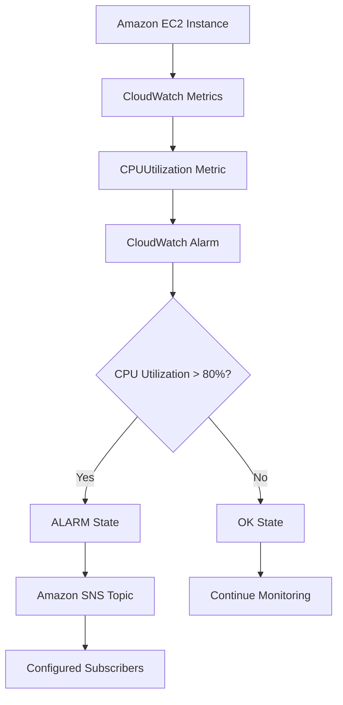
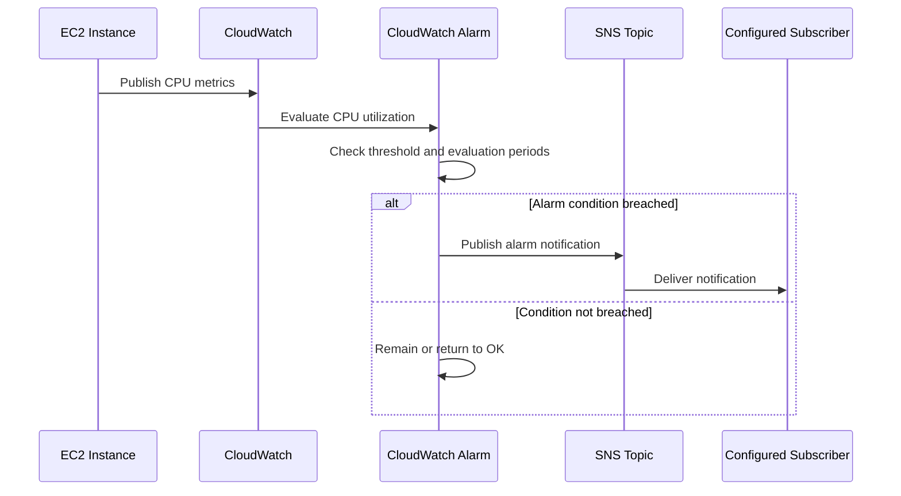

# Amazon CloudWatch – EC2 Monitoring and CPU Alarm

## 1. Overview

Amazon CloudWatch is an AWS monitoring and observability service used to collect metrics, monitor resource utilization, create alarms, and track operational performance.

In this project, CloudWatch was configured to monitor an EC2 instance using the CPUUtilization metric.

A CloudWatch alarm named `Yash-EC2-High-CPU-Alarm` was created to detect high CPU utilization. The alarm uses an Amazon SNS topic to provide notification integration.

### Objectives

- Understand Amazon CloudWatch monitoring.
- Monitor EC2 CPU utilization.
- Configure a CloudWatch alarm.
- Define an alarm threshold.
- Integrate the alarm with Amazon SNS.
- Understand alarm states and monitoring periods.
- Review alarm history and troubleshooting methods.

## 2. AWS Services Used

| AWS Service | Purpose |
|---|---|
| Amazon CloudWatch | Collects and monitors AWS metrics |
| Amazon EC2 | Resource being monitored |
| Amazon SNS | Notification delivery integration |
| AWS IAM | Controls access to monitoring resources |

## 3. Architecture Diagram



## 4. Understanding Amazon CloudWatch

CloudWatch provides monitoring capabilities for AWS resources and applications.

Its main components include:

### 4.1 Metrics

Metrics are numerical measurements collected over time.

Examples:
- CPU utilization
- Network traffic
- Disk activity where supported
- Request counts
- Application performance measurements

### 4.2 Alarms

CloudWatch alarms evaluate metrics against configured thresholds.

An alarm can change state when a metric meets the configured condition.

### 4.3 Dashboards

CloudWatch dashboards provide a visual overview of selected metrics and alarms.

### 4.4 Logs

CloudWatch Logs stores and provides access to log data from supported AWS services and applications.

**Note:** CloudWatch metrics, alarms, dashboards, and logs are separate capabilities. Creating an alarm does not automatically mean that application logs or a custom dashboard have been configured.

## 5. EC2 CPU Utilization Monitoring

The project uses the EC2 metric:

`CPUUtilization`

This metric represents the percentage of allocated EC2 compute capacity being used.

CPU utilization is useful for identifying:
- High processing load.
- Unexpected resource consumption.
- Potential performance bottlenecks.
- Workloads that may require scaling.

### Monitoring Configuration

| Setting | Project Configuration |
|---|---|
| Metric namespace | AWS/EC2 |
| Metric name | CPUUtilization |
| Alarm name | Yash-EC2-High-CPU-Alarm |
| Threshold type | Static |
| Comparison operator | Greater than |
| Threshold | 80% |
| Period | 5 minutes |
| Evaluation period | Configured during alarm creation |
| Notification integration | Amazon SNS |
| SNS topic | Yash-EC2-CloudWatch-Alerts |

## 6. CloudWatch Alarm Configuration

The project includes a high-CPU alarm.

### Alarm Condition

The alarm evaluates whether:

`CPUUtilization > 80%`

The configured monitoring period is five minutes.

When the metric satisfies the configured alarm evaluation criteria, CloudWatch can transition the alarm into the ALARM state.

### Alarm States

| Alarm State | Meaning |
|---|---|
| OK | Metric is within the configured acceptable condition |
| ALARM | Metric has breached the configured threshold according to the evaluation settings |
| INSUFFICIENT_DATA | CloudWatch does not have enough data to determine the state |

### Alarm Workflow

1. EC2 publishes CPU utilization metrics.
2. CloudWatch collects the metrics.
3. The alarm evaluates the metric.
4. CloudWatch determines the alarm state.
5. When the alarm enters ALARM, its configured SNS action can publish a notification.

## 7. Amazon SNS Integration

Amazon Simple Notification Service (SNS) is a managed messaging service that distributes notifications to subscribers.

The project uses the SNS topic:

`Yash-EC2-CloudWatch-Alerts`

The CloudWatch alarm is associated with this topic for notification integration.

### Notification Flow



**Important:** Alarm-to-SNS integration is configured in this project. Actual notification delivery should be independently verified by checking SNS subscription confirmation and alarm notification history.

## 8. Alarm Monitoring and Validation

The following checks help verify the configuration.

### AWS Console Navigation

1. Open AWS Management Console.
2. Search for **CloudWatch**.
3. Open CloudWatch.
4. Navigate to **Alarms → All alarms**.
5. Search for `Yash-EC2-High-CPU-Alarm`.
6. Open the alarm.
7. Review the metric, threshold, period, and alarm state.
8. Check the configured notification action.
9. Review alarm history for state transitions.

### Validation Checklist

| Validation | Expected Result | Project Status |
|---|---|---|
| CloudWatch alarm created | Alarm exists | Configured |
| Alarm name | Yash-EC2-High-CPU-Alarm | Verified |
| Metric | CPUUtilization | Configured |
| Threshold | Greater than 80% | Configured |
| Period | 5 minutes | Configured |
| SNS integration | Yash-EC2-CloudWatch-Alerts | Configured |
| Alarm evaluation | State changes according to configured criteria | Review in console |
| Notification delivery | Subscriber receives notification | Verify separately |

## 9. Testing High CPU Utilization

A controlled CPU load test can help demonstrate alarm behavior.

**Caution:** Perform this test only on a suitable test instance. High CPU utilization can affect application availability and may generate additional costs.

For Amazon Linux, one possible test command is:

```bash
sudo dnf install -y stress-ng
```

Then generate a short CPU load:

```bash
stress-ng --cpu 2 --timeout 360s
```

Monitor the instance's CPUUtilization metric in CloudWatch.

After the test:
- Stop the workload.
- Allow CPU utilization to return to normal.
- Review the alarm history.
- Verify the transition back to OK when the configured recovery criteria are met.

The test should be performed only when the alarm's evaluation configuration and instance capacity make it appropriate. Do not assume that a short load automatically triggers the alarm.

## 10. Troubleshooting

### Issue 1: No CloudWatch Metrics

Possible causes:
- Wrong EC2 instance selected.
- Incorrect metric namespace.
- Incorrect region.
- Metric data has not arrived yet.

Recommended actions:
1. Check the selected AWS region.
2. Verify the EC2 instance ID in the metric selection.
3. Open CloudWatch Metrics.
4. Select EC2 metrics and CPUUtilization.
5. Review the metric time range.

### Issue 2: Alarm Shows INSUFFICIENT_DATA

Possible causes:
- Not enough metric data.
- Incorrect metric dimensions.
- Instance is stopped.
- Metric has not been published during the selected time range.

Recommended actions:
- Check the EC2 instance state.
- Verify metric dimensions.
- Review the alarm's evaluation configuration.
- Wait for sufficient metric data.

### Issue 3: Alarm Does Not Enter ALARM

Possible causes:
- CPU utilization did not exceed the threshold.
- Evaluation periods were not satisfied.
- The wrong metric or instance was selected.
- The selected time range does not include the test.

Recommended actions:
- Review the alarm configuration.
- Inspect the CPUUtilization graph.
- Review alarm history.
- Perform a controlled test if appropriate.

### Issue 4: SNS Notification Not Received

Possible causes:
- SNS subscription is not confirmed.
- Wrong SNS topic selected.
- Alarm action is not enabled.
- Notification delivery failed.

Recommended actions:
1. Open Amazon SNS.
2. Open the `Yash-EC2-CloudWatch-Alerts` topic.
3. Review its subscriptions.
4. Confirm the subscriber's status.
5. Check CloudWatch alarm actions and history.
6. Review SNS delivery status where available.

## 11. Security and Cost Considerations

### Security Best Practices

- Restrict permissions for modifying CloudWatch alarms.
- Restrict access to SNS topics and subscriptions.
- Avoid exposing operational notifications publicly.
- Review alarm actions periodically.
- Use IAM policies based on least privilege.

### Cost Considerations

CloudWatch and SNS may incur charges depending on usage and service pricing.

Monitor:
- Number of alarms.
- Metric usage.
- Custom metric ingestion.
- Dashboard usage.
- Log ingestion and storage.
- SNS notification volume.

## 12. Project Outcome

Amazon CloudWatch was configured to monitor EC2 CPU utilization using the `CPUUtilization` metric.

A high-CPU alarm was created with a threshold greater than 80% and a five-minute monitoring period. The alarm was integrated with the SNS topic `Yash-EC2-CloudWatch-Alerts`.

This implementation demonstrates basic AWS infrastructure monitoring, threshold-based alerting, and notification integration.

## 13. Key Learning Outcomes

- Understanding CloudWatch metrics.
- Monitoring EC2 resource utilization.
- Creating metric-based alarms.
- Understanding OK, ALARM, and INSUFFICIENT_DATA states.
- Integrating CloudWatch alarms with SNS.
- Reviewing monitoring history.
- Troubleshooting monitoring and notification issues.

---

**Project:** AWS Automation, Serverless and Event-Driven Application  
**AWS Region:** ap-northeast-3 (Asia Pacific – Osaka)  
**Documentation Section:** Monitoring and Alerting  
**Author:** Yash Satyavan Jogdand  
**GitHub:** [yash-jogdand](https://github.com/yash-jogdand)
